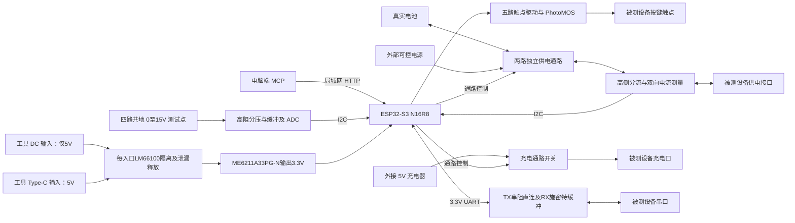

# MCU 开发辅助工具硬件方案

> 2026-11-10当前装配更新：PCB已回板，已按授权完成16个位号的物料统一。Q1～Q7/Q14共8颗为AO3400A/C20917，八颗GPIO栅极串阻统一240Ω/C114613，10kΩ下拉保持；R83/R84的1kΩ统一C22548。当前共37种采购物料、140颗/415脚，原板焊盘、铜几何及CPL坐标方向保持。当前BOM及独立后台检查以[物料统一修改记录](已回板物料统一修改记录.md)为准；下文旧TLP176AM、NPN、680Ω/330Ω/4.7kΩ基极驱动等内容保留为设计历史，不用于本批装配。U12仍为INA228，电容、功率P-MOS及光继电器未另换料。

> 2026-11-03充电器件统一：独立充电页Q12/Q13已由CSD25402Q3A改为AP60P20Q（C2828591），与主供电共用型号；原NPN和驱动阻容保持。当前按新S=1/2/3、G=4、D=合并5脚连接，下文旧TI脚号表仅作历史依据。当前实施见[独立充电P-MOS统一型号核验](独立充电P-MOS统一型号核验.md)。

> 2026-11-02主供电更新：用户确认C2828591后，两路主供电原理图已改为AP60P20Q共源背靠背P-MOS、AO3400A下拉、47kΩ上拉、1kΩ限流和6.2V栅源限压，移除两颗VOM1271T。工作目标改为2.8～12V/3A，不保证接近0V时充分导通，电压测量量程独立保留。当前连接及核验以[AP60P20Q改版核验](AP60P20Q主供电原理图改版核验.md)为准，下文旧N-MOS/光伏驱动选型保留作历史依据。PCB最后统一同步。

> 当前实施更新：本地嘉立创原理图的逐项复核见[记录](原理图逐项复核记录.md)。2026-10-31，五路按键继电器U5～U9已改为C7435105（GAQY221S，SOP-4），旧TLP176AM选型及KiCad对照不再代表这五颗器件的当前料号；驱动参数及脚号映射见[替换核验](GAQY221S固态继电器替换核验.md)。PCB待原理图全部确认后统一修改。

状态：首版模块方案与原生原理图初稿，待采购属性、封装、PCB及样机复核，不可作为投板依据。

2026-10-24，按用户要求改用 [KiCad 原生工程](../hardware/kicad/README.md)，重新绘制总览及八个功能图页。164颗器件、508个物理引脚，124个网络与已确认连接零差异，KiCad 10.0.6默认启用规则下ERC无违规；PDF逐页检查已完成；客户端已载入全部图页，并通过运行时实时网表核验，桌面截图及交互保存仍未验证。J1/J2封装及制造待核项见工程说明。[嘉立创初稿](../hardware/easyeda-pro/README.md)保留为历史快照。

## 主控评估结论

用户指定的 ESP32-S3 N16R8 配置适合本项目。Wi-Fi、命令执行、按键时序、一路目标串口及测量缓存有足够资源，当前不需要因 GPIO 数量增加扩展芯片。

已确定采用 ESP32-S3-WROOM-1-N16R8 模组直接焊接工具 PCB：16MB Quad Flash、8MB Octal PSRAM、板载天线，支持 2.4GHz Wi-Fi。

官方参数、模组与裸片区别、引脚限制和来源见 [主控适配评估](ESP32-S3-N16R8主控适配评估.md)。主控不承担精密模拟测量，外部 ADC 和电流监测器件负责计量。

## 模块连接

外部可控电源的调压由项目侧 AI 直接操作，不经过主控转发。图中真实电池/外部电源通路已按正电压 0～15V、双向 3A 作为设计目标，充电通路为独立 5V/2A；这些是待器件和实测核验的额定目标。

## 外围选型方向

| 模块 | 候选方向 | 当前边界与验证重点 |
| --- | --- | --- |
| 双向电流 | 原理样机推荐 INA228AIDGSR＋WSK2512R0200BEA，20mΩ/0.1%/四端分流，固定宽档 | 幅值3A；0～10mA误差目标±100µA，超过10mA至3A为±读数的1%；15～35℃、每台零点与增益校准；整机精度及约1秒读数待验证，分流器供货和报价待核 |
| 电池接口电压 | 优先复用电流监测芯片电压通道，INA228 VBUS 为候选，具体器件未定 | 开关及分流之后的工具输出端测量；0～15V、1mV 分辨率、约每秒 1 组；误差目标 ±（读数的 0.2%＋5mV），15～35℃且零点与增益校准，不包含外接线缆压降 |
| 四路电压 | 用户指定降本版：ADS1115IDGSR＋TLV9001IDBVR×4；每路10MΩ/1MΩ分压、3.3V单电源跟随器 | 共地0～15V，原始输入等效步长0.6875mV；保持1mV分辨率，近零允许偏差，其余区间以±（0.2%读数＋5mV）为目标、输入阻抗≥5MΩ和约1秒四路一轮目标；15～35℃每路校准，实际误差、近零及供电瞬态待验证 |
| 五路按键 | 用户已认可原理图初稿：TLP176AM＋onsemi MMBT3904LT1G；每路 LED 240Ω、基极680Ω、B-E下拉10kΩ，均1% | 独立两端触点≤6V、≤20mA、无极性、10ms级动作；仍需带载GPIO、温度、动作及默认状态实测后定版 |
| 两路供电开关 | 用户已认可初稿：每路 VOM1271T＋两颗 CSD17577Q3A＋MMBT3904LT1G；LED100Ω、基极330Ω、B-E下拉10kΩ | 主通路0～15V/双向3A目标；两路互斥、先断后通；共源共栅连接，栅驱、瞬态和动作时长待实测后定版 |
| 充电通路开关 | 原理样机推荐两颗 P-MOS CSD25402Q3A＋MMBT3904LT1G，共源共栅；栅源上拉10kΩ、栅极串阻100Ω、基极4.7kΩ、B-E下拉10kΩ | 独立5V通路，只切正极；关闭双向阻断，沿用2A/100mV及100ms量级目标与真实电池充电互锁；具体表现待实测 |
| 目标 UART | TX经100Ω直连，RX保留Nexperia 74LVC1G17GV,125施密特缓冲和470kΩ下拉 | 3.3V、9600～921600常用波特率、默认115200/8N1、全双工字节透传；TX禁用由GPIO14输入、无上下拉实现，RX仍工作；逻辑电平、接入负载、反灌及线缆条件待验证 |
| 内部工作电源 | 两入口均仅5V；SS34隔离后接ME6211A33PG-N（C236673）；输入/输出均10µF陶瓷 | 用户接受标称500mA余量取舍；旧0.75A不再作为当前能力，实际电流、稳定性和温升待样机 |
| 下载调试 | J2 Type-C接原生USB Serial/JTAG，兼作供电、下载、日志和命令交互；删除J3 | USB接电脑不接DC；BOOT/RESET保留；固件配置及协议待实现 |
| 本机操作与指示 | BOOT、RESET、独立配网键；一颗电源 LED、一颗状态 LED | 电源灯使用工具自身电源，状态灯用于配网及联网状态；配网长按时间及闪烁规则待固件定义 |

两路供电开关及充电通路的背靠背 MOS 架构已确认，表中具体器件均未定型。测流和分压电路的器件级参数不能直接当作整机测量精度，通路开关的芯片电流额定值也不能直接当作整机载流能力。

具体参数、输入负载计算、继电器与 MOS 比较及官方出处见 [外围器件候选评估](首版外围器件候选评估.md)。

0V 附近通路的驱动依据、双 MOS 接法及待验证条件见 [双向功率开关评估](零至十五伏双向功率开关评估.md)。机械继电器保留为器件比较资料，当前不设计运行时备用通路或自动换源。

板内供电通路在 3A 时总压降不超过 150mV 已确认为设计目标，口径包含开关、采样电阻、PCB 走线及板载端子，不包含外接线。现有 20mΩ 分流候选在 3A 时占 60mV，其他部分合计预算约 90mV；温度及容差仍须计入验证。

本地切换动作按 100ms 量级完成设计，指旧支路关断、新支路接通，不包含网络传输、设备电容放空或设备重启。具体先断后通间隔仍需按所选驱动和 MOS 实测，不能把当前器件算例当作整机保证。

充电通路的 2A/100mV 目标对应板内总电阻不超过 50mΩ，包含开关、走线及板载端子，不含外接线，也不包含另一条电池端测流通路的分流电阻。充电开关本地通断动作按 100ms 量级设计，不保证充电口电压在此时间内归零或设备已经识别插拔；开启状态不承诺主动反向阻断。

首批电路验证优先顺序为：固定分流测流 → 四路电压前端 → 带 UART/测量探线的自负载 → 功率通路压降和漏电 → Wi-Fi 工作时整机精度。先以参考仪表核验模拟部分，再连接 MCP 做端到端测试。

## 外部测试连接器

外部测试接口连接器已统一确定为2.54mm排针，覆盖BAT_IN、EXT_IN、DUT_PWR、CHG_IN、DUT_CHG、KEY1～KEY5、AIN1～AIN4及目标UART。2026-10-23确认首版使用朝上的直排针。电源通路保留正负两端，五路按键各保留两个独立浮动触点；四路电压接口已确认各用独立1×2排针，1脚AIN、2脚COMMON_GND，四个地针在板内共地；UART为TX/RX/GND。针位及丝印初稿见 [排针接口与丝印定义](排针接口与丝印定义.md)。工具自身电源使用已确认的DC和Type-C。

主通路 3A、充电通路 2A 的设计目标继续保留。连接器选型须同时核验板端排针、线端插座及线材的额定承流、接触电阻和温升，并计入既有通路压降预算，不把针距当作电流额定值。

## GPIO 分配提案

按已确定的 ESP32-S3-WROOM-1-N16R8 模组核验，共 17 根；最终仍需结合原理图与驱动极性复核。所有初始状态均需要外部驱动及偏置电阻配合。

| GPIO | 提案信号 | 角色及初始要求 |
| --- | --- | --- |
| 4 | KEY1_CTRL | 按键 1 驱动，上电不闭合 |
| 5 | KEY2_CTRL | 按键 2 驱动，上电不闭合 |
| 6 | KEY3_CTRL | 按键 3 驱动，上电不闭合 |
| 7 | KEY4_CTRL | 按键 4 驱动，上电不闭合 |
| 8 | KEY5_CTRL | 按键 5 驱动，上电不闭合 |
| 9 | I2C_SDA | 电流监测器及电压 ADC 共享数据线 |
| 10 | I2C_SCL | 共享时钟线 |
| 11 | BAT_PATH_EN | 真实电池通路控制，上电关闭 |
| 12 | EXT_PATH_EN | 外部电源通路控制，上电关闭 |
| 13 | CHARGE_PATH_EN | 充电通路控制，上电关闭 |
| 14 | DUT_UART_TX | 经 GPIO Matrix 映射目标串口发送 |
| 15 | DUT_UART_RX | 经 GPIO Matrix 映射目标串口接收 |
| 16 | STATUS_LED | 已确认普通状态 LED，用于配网及联网状态 |
| 17 | CONFIG_KEY | 人工配网键，不复用启动模式脚 |
| 18 | CURRENT_ALERT | 电流监测告警输入，可选 |
| 21 | ADC_READY | ADC 转换就绪输入，可选 |
| 38 | 预留 | 原UART发送使能已取消，原理图标记未连接 |

GPIO0和EN保留BOOT/RESET操作；GPIO19/20专用于原生USB D−/D+，GPIO43/44预留未连接，已删除UART0下载排针。GPIO39～42可保留调试；GPIO35/36/37由Octal PSRAM占用，GPIO26～32不作业务使用。

GPIO 空闲容量足够，因此首版可以优先保证独立控制和默认关断，不必挤占启动、下载或存储器引脚。

## 电路连接草案

下表使用信号名描述连接，不包含封装引脚号；原理图绘制时须对照最终可购料号逐脚映射。

| 网络/端口 | 连接关系及定义 |
| --- | --- |
| DC_IN_5V / TYPEC_IN_5V → LDO_VIN | DC为5.5×2.1mm、内正外负，与Type-C均仅接5V；CC1/2各5.1kΩ；每入口经SS34后汇合，各原始入口1µF及4.7kΩ到地；后接ME6211A33PG-N及输入/输出各10µF陶瓷电容，人工每次只接一路 |
| BAT_IN_P / EXT_IN_P | 各经独立双 MOS 全关断开关，再汇合为 VSEL_P；两路互斥 |
| VSEL_P → RSHUNT → DUT_PWR_P | 20mΩ 高侧分流串接在公共输出，IN+、IN− 接其四端开尔文采样点；正电流定义为向被测设备供电 |
| DUT_PWR_P → VBUS | 电池接口电压测点确定在开关及分流之后的工具输出端；若采用 INA228，其 VBUS 接该测点，不占四路外部输入，输入取电经过分流器 |
| CHG_IN_P → CHG_SW → DUT_CHG_P | 外接5V充电器经共源背靠背P-MOS候选通路连接设备充电口，GPIO13经NPN驱动；地保持连接，目标2A，与电池测流通路区分 |
| COMMON_GND | 工具、供电端口、四路测量及目标 UART 共地；五路按键的外部触点各自独立，不接 COMMON_GND |
| 光伏 MOS 驱动 | 每路两颗 MOS 共源、共栅，驱动正端接共栅、负端接共源；控制 LED 由工具供电、GPIO 经匹配驱动级控制 |
| KEY1～KEY5 | 每路 TLP176AM 的4/6脚接独立2.54mm两针接口；1脚经240Ω接工具3.3V，3脚接MMBT3904LT1G集电极；GPIO经680Ω接基极，B-E间10kΩ下拉，发射极接工具地；这些为原理样机初值 |
| AIN1～AIN4 / AGND | 每路单颗10MΩ上臂/1MΩ下臂，进入独立TLV9001及输出RC后接ADS1115；运放采用3.3V单电源跟随器，近零允许偏差，详见四路电压电路节 |
| I²C 地址及上拉 | INA228 A0/A1接GND，7-bit地址0x40；ADS1115 ADDR接GND，7-bit地址0x48；SDA/SCL各用一颗4.7kΩ上拉至工具3.3V作为绘图初值，共享总线不重复增加各模块上拉，按实际电容和速率核验上升沿 |
| 测量 IC 去耦及滤波 | INA228、ADS1115 和缓冲器各就近 0.1µF 去耦；电流差模滤波可由每臂10Ω与跨输入100nF 开始验证，加载误差计入预算 |
| DUT_UART_TX/RX/GND | 工具GPIO14经100Ω直接接设备RX；设备TX经100Ω进入施密特接收缓冲，再到GPIO15；三针接口无VCC，RX输入470kΩ对地下拉，详见UART电路节 |
| 原生USB下载与交互 | J2的A7/B7接USB_DM，经R85=22Ω接GPIO19；A6/B6接USB_DP，经R86=22Ω接GPIO20；D5=C2687116 |
| BOOT / RESET / CONFIG | 三颗TS-1009S-03826（C455243）常开按键，分别连接GPIO0、EN、GPIO17；保留既有上拉与复位RC，按下接地 |
| POWER_LED / STATUS_LED | 电源LED从工具3.3V经限流取电，状态LED由GPIO16控制；本次绘图各取1kΩ限流初值，LED具体料号、亮度及带载电压待核；不从被测设备电池通路取电 |

目标UART发送可独立于接收启停。取消硬件发送缓冲后，固件初始化及禁发送时须解除TX外设驱动，将GPIO14设为输入、无上下拉；由AI显式启用，掉电测试前先禁TX。上电至初始化前及复位过程的实际引脚状态待验证。接口仅TX/RX/GND，无供电针；100Ω不提供掉电隔离，不能据软件状态宣称无反灌。

充电器输入电流和电池净充电电流不是同一个量。当前 INA228 测量电池端通路的双向电流，不把该读数当作充电器 5V 输入总电流。

电流分段精度及约每秒 1 组稳定读数已确认，正反方向要求相同；不承诺捕获启动瞬间电流峰值。精度验收条件为环境 15～35℃、每台完成一次零点与增益校准。20mΩ 候选在 3A 时产生 60mV 压降和 0.18W 发热；精度预算仍须包含失调、增益、分流容差、温漂、噪声及接入负载，不能以一次校准代替全条件验证。

[早期电压前端核算](四路电压前端与测量自负载核算.md)保留7MΩ/1MΩ等历史候选。2026-10-23的原理样机推荐改为10MΩ/1MΩ，以满足精密缓冲器的低共模误差区间；每路15V时分压电流名义1.364µA，四路同挂15V节点时共5.455µA，保护、缓冲偏置和板面漏电另计。高阻的偏置、漏电及整机误差仍需验证，不能把典型参数或接入前后电压相近解释为测量没有影响被测设备。

四路电压检测的设计目标已确认：每路绝对误差 ±（读数的 0.2%＋5mV），环境 15～35℃、每路完成零点与增益校准；输入阻抗不低于 5MΩ，15V 时实际输入取电不超过 3µA/路，须计入保护及缓冲的加载；四路全部更新约 1 秒一轮，允许顺序采样，不要求同步，不承诺瞬间尖峰或跌落捕获。1mV 为分辨率；四路与电池接口电压分别校准、验收，四路输入阻抗目标不自动扩展到 INA228 VBUS。

电池接口电压测点已确定在开关及分流之后的工具输出端，不包含外接线缆压降，不直接称为设备 PCB 实际电压。若采用 INA228 VBUS，其输入取电流过分流器，15V 时按已有手册阻抗范围估算约 12.5～18.75µA，实际负载须验证并披露。电流读数定义为分流器双向总电流，包含经过该通路的测量接入负载；不自动扣除名义固定值，也不将其直接等同于设备未接工具时的自身耗电。

设备查询应区分控制状态与电气测量值。GPIO 已被设置不等于已经反馈验证了 MOS 实际导通，验收仍按参考仪表检查物理结果。

光伏驱动内部有门极关断结构，不按普通 MOS 电路习惯直接加入 100kΩ 栅源下拉。其微安输出不足以承担这种持续负载；外部钳位及泄漏、全温驱动和残余电荷仍需专项核算。

## 主控最小系统连接

以下按 ESP32-S3-WROOM-1-N16R8 模组核验，模组焊盘编号不能与 GPIO 编号混用；资料依据和时序条件见 [最小系统连接核验](ESP32-S3模组最小系统连接核验.md)。本节连接已用于原生原理图初稿，尚未实测。

| 网络/功能 | 模组焊盘 | 主板连接 |
| --- | --- | --- |
| 工具 3.3V | 2：3V3 | 接工具内部稳压输出，模组供电入口就近配置 22µF＋0.1µF，电容有效容量和稳压启动仍需核验 |
| 地 | 1、40：GND；41：EPAD | 1、40 接地；EPAD 建议接主板地并按官方封装处理，焊接 EPAD 不是官方强制条件 |
| EN / RESET | 3：EN | EN经10kΩ上拉至3.3V、1µF接地，RESET按键SW1（C455243）将EN拉地；原下载排针已删除 |
| BOOT | 27：GPIO0 | BOOT按键SW2（C455243）将GPIO0拉地，保留10kΩ上拉；配合RESET进入USB下载，不增加大容量去抖 |
| UART0 TX | 37：GPIO43/TXD0 | 预留未连接；已删除J3，下载和控制台改走原生USB |
| UART0 RX | 36：GPIO44/RXD0 | 预留未连接；目标业务UART保持独立 |
| USB D− | 13：GPIO19 | 经R85=22Ω接USB_DM，J2 A7/B7与D5的1/6脚接同网 |
| USB D+ | 14：GPIO20 | 经R86=22Ω接USB_DP，J2 A6/B6与D5的3/4脚接同网 |
| 状态 LED | 9：GPIO16 | 经匹配限流电阻驱动普通 LED，具体阻值随 LED 型号及亮度核算 |
| 配网键 | 10：GPIO17 | 独立按键SW3（C455243）输入，按下接地，保留10kΩ上拉至3.3V；不复用BOOT |

手动下载需在复位采样时满足 GPIO0=0、GPIO46=0；GPIO46 为模组焊盘16，建议外部 10kΩ 下拉明确启动电平，该阻值是工程建议。电源稳定至 EN 拉高、EN 低电平复位均需满足官方最小 50µs 条件，绑带状态在 EN 上升后还需保持至少 3ms；不能将 RC 标称值等同于全部上电情况下时序已通过。下载入口现为原生USB；J3已删除，BOOT/RESET及其偏置保持。

## 原生USB下载与交互

2026-11-04用户确认删除J3五针UART0下载排针，将现有J2 Type-C升级为供电、下载、日志与双向命令交互共用接口。GPIO19/20分别接D−/D+，各串22Ω，接口配置友台USBLC6-2SC6（D5/C2687116）。BOOT、RESET、配网键及目标UART保持。见[原生USB接口改版核验](原生USB接口改版核验.md)。

USB Serial/JTAG可自动进入下载模式，必要时按住BOOT再复位。固件后续须启用USB控制台并实现接收及命令处理，日志/响应的区分待协议设计。只开次级USB日志输出不能提供命令输入；复用USB引脚或进入睡眠会影响连接。没有增加自动回退或恢复机制。

沿用人工二选一供电：USB接电脑时不接DC，DC供电时通过Wi-Fi使用；电脑USB供电能力不等同于5V/2A适配器，须验证启动与Wi-Fi瞬态。首版USB业务通信现已纳入，Wi-Fi能力继续保留。当前只完成原理图，PCB及固件待后续处理。

## 五路按键单路电路

采用五套相同单路电路，KEY1～KEY5 分别由 GPIO4～GPIO8 控制。用户已认可 **TLP176AM(TPL,E＋onsemi MMBT3904LT1G** 及下述阻值作为原理图初稿；具体引脚、手册条件及计算见 [按键驱动器件核验](五路按键驱动器件核验.md)。尚无原理图定版或硬件实测。

| 单路连接 | 原理样机参数 |
| --- | --- |
| 工具3.3V → RLED → TLP176AM 1脚（阳极） | RLED=240Ω，1%，额定功率≥0.1W，0603候选 |
| TLP176AM 3脚（阴极） → Q的3脚（集电极） | Q=onsemi MMBT3904LT1G，SOT-23，按该厂商引脚核对封装 |
| Q的2脚（发射极） → 工具GND | 控制侧接地，不连接外部按键触点 |
| KEYn_CTRL → RB → Q的1脚（基极） | RB=680Ω，1%，0603候选 |
| Q的1脚（基极） → RBE → Q的2脚（发射极） | RBE=10kΩ，1%，GPIO高阻时将基极拉低 |
| TLP176AM 4脚、6脚 → KEYn_A、KEYn_B | 独立2.54mm两针输出，无极性，不接工具地；SO6-4封装的2/5位置无引脚 |

GPIO 高电平点亮内部 LED、闭合对应触点；低电平或高阻时释放。B-E 下拉只明确 GPIO 高阻时的偏置，不能替代上电、硬复位、软件重启及下载待机时的波形验证；所有这些状态仍须满足既定默认断开要求。

以3.3V、LED正向压降约1.27V、NPN压降约0.1V作名义估算，每路 LED 电流约8mA，五路同时按下约40mA，另计GPIO基极驱动电流；全部取自工具自身电源。名义电压不是实测值，不能当作全温保证。

电流余量按3.0～3.6V核算包络、1%电阻分析：若 VF≤1.4V、VCE≤0.3V，则240Ω方案在低电压端约5.36mA；270Ω同条件约4.77mA，因此初值选240Ω。仅用 VF、VCE 非负的粗保守上界，240Ω在3.6V时约15.15mA，电阻耗散不超过约54.55mW。VF/VCE预算的电流、温度条件必须验证，不能把手册10mA/25℃的VF范围无条件外推。

若带载GPIO高电平至少2.4V、VBE不超过0.95V，则680Ω基极电阻和10kΩ下拉在容差下提供基极电流约2.02mA；这是待实测的工程条件，不以ESP32高阻负载VOH表项替代带载保证。

五路用量为：TLP176AM 5颗、MMBT3904LT1G 5颗、240Ω/680Ω/10kΩ各5颗，以及十个外部触点针位。PhotoMOS沿用[2026-10-17核价记录](五路按键模块成本核价.md)约24.63元/五颗的历史参考，NPN、阻值件及排针仍需实际核价，不据此宣称完整模块成本已通过。

验证重点为：电源上下限下的LED电流和GPIO带载电平、五路组合动作、正反极性的6V/20mA通断、关断漏电、10ms级按下/释放及各类复位时的实际触点状态。手册最大3ms开通、0.5ms关断有指定测试条件，命令1ms步进不能当成1ms物理动作精度，也不自动添加时长补偿。

## 两路供电开关单路电路

真实电池支路与外部可控电源支路各复制一套电路，由 GPIO11/BAT_PATH_EN 和 GPIO12/EXT_PATH_EN 控制，合流后进入公共分流测量通路。用户已认可 **Vishay VOM1271T＋两颗 TI CSD17577Q3A＋onsemi MMBT3904LT1G** 及下述阻值作为原理图初稿；准确引脚、工程预算和待验证项见 [单路器件核验](双路供电开关单路器件核验.md)。本节只细化两路供电选择，充电通路单独处理，尚未实测定版。

| 单路器件/网络 | 初稿连接 |
| --- | --- |
| 输入侧功率MOS QIN | CSD17577Q3A：D=5/6/7/8/9，接 BAT_IN_P 或 EXT_IN_P；S=1/2/3，接本支路 SCOM；G=4，接本支路 GCOM |
| 输出侧功率MOS QOUT | 同型号：D=5/6/7/8/9，接公共 VSEL_P；S=1/2/3 接本支路 SCOM，G=4 接本支路 GCOM |
| VOM1271T 输出 | 4脚正端接 GCOM，3脚负端接 SCOM；这是浮动栅源驱动，SCOM不接工具地，两条支路的SCOM/GCOM分别独立 |
| VOM1271T 输入 | 工具3.3V → 100Ω/1% → 1脚阳极；2脚阴极接驱动NPN集电极 |
| 驱动NPN | MMBT3904LT1G：3脚C接光伏驱动LED阴极，2脚E接工具地，GPIO经330Ω/1%接1脚B，B-E间10kΩ/1%下拉 |
| 输入限流电阻 | 100Ω选1206、额定≥0.25W作为样机起点；330Ω和10kΩ可选0603、额定≥0.1W，最终料号按板温核验 |

**CSD17577Q3A底部大焊盘9为漏极。** QIN的大焊盘属于该路电源输入，QOUT的大焊盘属于公共输出，不能将它们合并为共源铜皮；S/G仅按上表相连。两个功率MOS全部源极焊盘及漏极焊盘按同一电气网络接入，封装和底焊盘按官方图处理。

单路LED在3.3V、VF约1.4V、NPN压降约0.1V的算例中约18mA，这是工程工作点，不是厂商另列的推荐范围。按3.0～3.6V、1%阻值，若VF≤1.6V且VCE≤0.3V，则100Ω低端预算约10.89mA；120Ω仅约9.08mA，故暂选100Ω。VF/VCE非负的粗上界为36.36mA，限流电阻耗散粗上界约130.9mW，因此不按普通0.125W件核算。

若带载GPIO高电平≥2.4V、VBE≤0.95V，则330Ω和10kΩ在容差下提供基极电流约4.25mA；上述电压均为须实测核验的工程预算。VOM1271输入LED的绝对最大值及温度降额单独核对，不能把25℃的50mA绝对最大值当作全温工作规格。

在实测栅源电压足够、按手册 VGS=4.5V/25℃的最大电阻估算时，两颗MOS合计12.8mΩ：1A时约12.8mV，3A时约38.4mV、耗散0.1152W。计入20mΩ分流，3A时合计约98.4mV，距150mV总目标约剩51.6mV给连接器、走线及温升影响；这是预算，不是整机保证。

VOM1271内置关断结构，单路原理样机按官方双向MOS接法驱动共栅/共源，不套用普通100kΩ栅源下拉，也不增加未经泄漏核算的钳位器件。外部栅源保护、实际VGS上下界与端口瞬态仍需在定版前闭合；驱动器开路电压和小电容负载下的典型时间不能直接当作这两颗功率MOS的保证值。

控制只允许以下稳定状态：

| 供电状态 | BAT_PATH_EN | EXT_PATH_EN |
| --- | ---: | ---: |
| 关闭 | 0 | 0 |
| 真实电池 | 1 | 0 |
| 外部可控电源 | 0 | 1 |

换源时先检查已确认的充电互锁，冲突命令拒绝；关闭当前支路，经过按实际关断波形确定的间隔，再打开另一支路。不得同时开启两个驱动，不把100ms量级动作目标当成固定互锁延时，也不把输入LED熄灭等同于MOS已瞬间断开。未接反馈电路前，命令状态不代表已独立测得物理关断。

表中只定义两路主供电选择。充电通路仍由独立命令及已确认互锁控制，不因本次硬件细化增加自动联动；充电开启时单独关闭真实电池通路的命令语义，在后续完整API状态设计中明确。

样机需先在受控电源和低能量负载下验证VGS、默认关闭、双向通断和实际开关边沿，再核验容性负载、SOA、压降和温升。100ms是动作完成目标，不代表允许MOS在明显压差和负载电流下持续线性导通100ms。量测VGS须以各自SCOM为参考并计入探头负载。两套合计VOM1271T 2颗、功率MOS 4颗、驱动NPN 2颗及三种电阻各2颗；当前没有该模块的完整人民币报价或实测结果。

## 独立5V充电通路电路

本路固定服务5V充电输入，原理样机推荐 **TI CSD25402Q3A×2＋onsemi MMBT3904LT1G×1**，采用共源共栅的背靠背P沟道MOS。关断时栅极上拉到本路共源节点，导通时由NPN拉低栅极；省去该路光伏驱动器，具体价格仍须核对。资料、生命周期和计算见 [五伏充电通路器件核验](五伏充电通路器件核验.md)。

| 单路器件/网络 | 原理样机连接 |
| --- | --- |
| 输入侧P-MOS QCHG_IN | CSD25402Q3A：D=1/2/3接CHG_IN_P；S=5/6/7/8/9接SCOM_CHG；G=4接GCOM_CHG |
| 输出侧P-MOS QCHG_OUT | 同型号：D=1/2/3接DUT_CHG_P；S=5/6/7/8/9接SCOM_CHG；G=4接GCOM_CHG |
| 栅源上拉RGS | 10kΩ/1%，连接GCOM_CHG与SCOM_CHG，不接工具3.3V；用于关断MOS，不是输出对地放电电阻 |
| 栅极串阻RG | 100Ω/1%，连接GCOM_CHG与驱动NPN的3脚C |
| NPN驱动 | MMBT3904LT1G：2脚E接工具GND；GPIO13/CHARGE_PATH_EN经4.7kΩ/1%接1脚B；B-E间10kΩ/1%下拉 |
| 地及外部接口 | 充电器负端、设备充电口负端和工具参考地共地；输入、输出分别使用2.54mm两针接口 |

四颗电阻可从0603、额定≥0.1W开始选型，栅极串阻的短脉冲及最终板温需核验。**CSD25402Q3A底部大焊盘9属于Source，两个大焊盘均接SCOM_CHG**，不能套用主供电N-MOS的Drain底盘电气定义。

GPIO13高电平时NPN导通并下拉GCOM_CHG，P-MOS的VGS为负、通路开启；低电平或高阻时NPN关闭，由RGS使栅极跟随共源，通路关闭。RGS必须接SCOM_CHG，若误接固定3.3V，5V共源时可能残留负VGS，不能保证默认关闭。工具失电、充电器先接入、设备端先有电和输入热插拔的实际默认状态仍须测波形验证。

稳态工程关系为 `|VGS|≈(VSCOM−VCE)×RGS/(RGS+RG)`。在VSCOM=5V、VCE预算0.3V的算例中约4.65V；VSCOM=4.5V时约4.16V，因此不能把名义5V下的算例当作全条件|VGS|≥4.5V保证。VCE及输入容差须结合实际电路核验。

先按手册VGS=-2.5V、25℃的最大RDS(on)=15.9mΩ/颗作保守静态预算：两颗合计31.8mΩ，2A时压降约63.6mV、总损耗约0.127W，距板内100mV目标约余36.4mV给温升、走线和连接器。只有验证实际|VGS|足够且对应温度条件适用，才可采用-4.5V条件8.9mΩ/颗的较低预算；两种口径都不等于整机已经达标。

在带载GPIO高电平≥2.4V、VBE≤0.95V的待验证假设下，4.7kΩ基极电阻和10kΩ下拉提供基极电流低端约0.209mA。正常充电方向、VSCOM约5V时，栅极偏置电流约0.5mA，由外接充电源提供；GPIO电流粗上界约0.774mA，来自工具3.3V。芯片内电阻/电容及温度变化仍须实测，GPIO高阻测试数据不能替代带载保证。

该接法用于5V充电通路，不能据此替换要求接近0V仍可受控导通的主供电驱动。两颗P-MOS体二极管反向串联，关闭时双向阻断；开启后仍可反向导通，不新增主动逆流保护、主动放电、自动限流或自动恢复。充电互锁沿用已确认规则，通路开关不承担被测设备的充电管理。

两颗MOS至-4.5V的门极电荷表列最大合计约19.4nC；这有助于建立关断时间量级，但不能用单一电流或RC值替代实际米勒过程与插拔波形。样机需验证5V及最终输入容差下的VGS、压降、温升、关断漏电、默认状态，以及真实接线和容性负载下的接通/断开波形。100ms仍为本地通断动作目标，关断后设备充电口电压自然消退，不承诺100ms内归零。

本路初始BOM为P-MOS两颗、NPN一颗、四颗电阻及输入/输出排针；目前仅完成器件资料和电路核算，没有该方案的完整人民币报价或样机结果。

## 电池端电流采样电路

原理样机推荐 **INA228AIDGSR＋Vishay WSK2512R0200BEA**。分流器为20mΩ、0.1%、真正四端结构，额定1W@70℃，该阻值档整件TCR为±35ppm/℃；不能用合金材料的温漂数值替代整件指标。完整后缀依据厂商编码表，尚未确认现货及人民币报价。官方来源、封装和配置核验见 [电池端电流采样器件核验](电池端电流采样器件核验.md)。

公共通路为 `VSEL_P → 分流器载流端 → DUT_PWR_P`。正电流表示从所选电源流向被测设备，反向充电为负。两路供电共用一个分流器；独立5V充电输入不串入该分流器，测得的是设备电池接口通路电流。

| 器件/引脚 | 原理样机连接 |
| --- | --- |
| 分流器载流端 | I1接VSEL_P，I2接DUT_PWR_P；I1/E1同端、I2/E2同端，位置按厂商图及专用四端足印映射，不套用普通两端2512封装 |
| INA228 IN+，10脚 | 从分流器E1独立采样端，经10Ω串阻接入 |
| INA228 IN−，9脚 | 从分流器E2独立采样端，经10Ω串阻接入 |
| 差模滤波电容 | 100nF跨接芯片侧IN+与IN−，紧靠芯片；不把两个采样端各接大电容到地 |
| VBUS，8脚 | 接DUT_PWR_P，在开关及分流之后测电池接口电压，不占四路外部检测通道 |
| VS/GND，6/7脚 | 工具3.3V/公共地；VS就近100nF去耦，工具供电独立于被测通路 |
| SDA/SCL，4/5脚 | 接GPIO9/10；共享I²C上拉至工具3.3V，同一总线不重复叠加各模块上拉 |
| A1/A0，1/2脚 | 均接GND，7-bit地址0x40 |
| ALERT，3脚 | 开漏信号接预留GPIO18，经10kΩ上拉到工具3.3V作为低速状态线初值；仅预留采集状态信号，不据此增加自动断电或过流保护行为 |

两颗10Ω可先采用1%/0603，100nF差模电容采用陶瓷器件；准确型号、瞬态应力及滤波效果随样机复核。此处10Ω在采样支路内，不承载3A主电流。两个10Ω和100nF形成约79.6kHz差模截止频率，主要滤除高频干扰；约1秒的读数平均由ADC配置承担。串阻产生的输入加载及失配须计入校准和误差预算，不能视为零误差。

| 实际电流幅值 | 20mΩ上的信号 | 对设计的意义 |
| --- | --- | --- |
| 100µA | 2µV | 与微伏级失调、热电势处于相近量级，须控制布局和校准误差 |
| 1mA | 20µV | 小电流验证点，仍使用同一固定量程 |
| 10mA | 200µV | 已确认绝对误差与相对误差的分段交界 |
| 3A | 60mV | 分流器耗散0.18W；按板内150mV总目标，分流器占60mV |

INA228固定使用ADCRANGE=0的±163.84mV宽档；窄档±40.96mV无法覆盖20mΩ上的3A。宽档原始电流量化步长约15.625µA，芯片最大±1µV失调折合±50µA（有转换时间等条件）。这些分别是量化步长与单项误差，均不是整机精度；继续按已确认的小电流±100µA及较大电流±读数1%目标验证。

采样初值采用连续分流电压＋VBUS转换，关闭温度通道，两通道转换时间各2074µs、平均128次。内部完整结果名义周期为 `2×2074µs×128＝0.530944s`，对外沿用约每秒1组读数。电流在平均窗口中途变化时，第一组结果可能同时含有变化前后的样本；完全由新状态形成的结果可能要接近两个周期，即名义约1.062s，外部信号建立、ADC时钟容差及软件读取延迟另计。刷新周期不能直接当作整机稳定时间，也不承诺捕获启动峰值。

256次平均时双通道周期约1.062s，完整新窗口等待可能接近2.124s，因此本轮以128次为优先验证初值。未增加运行时自动切档、自动重启转换或丢弃样本策略；噪声、精度、完整窗口时序及约1秒等待目标须一起验收，不能只靠增加平均次数使数字更平稳。

四端分流器的采样走线从独立电压端引出，成对、短且远离LM7705电荷泵、天线及功率开关节点；不能从载流铜箔远端取样。分流器、接插件和焊点的温差可能引入热电势，布局应远离LDO热源，验证应包含3A工作后的热稳定过程以及返回小电流后的零点变化。

零点和增益校准必须针对已定义的分流器总电流，并覆盖滤波与实际布局。VBUS从DUT_PWR_P取电，15V时按手册工作阻抗估算约12.5～18.75µA；即使设备未接，通路也不必然是零电流，不能把该读数直接强制归零。校准夹具、参考仪表及具体操作步骤后续明确；不增加运行中自动调零或固定自负载扣除。

首批验证覆盖双向100µA/1mA/10mA及3A、分段交界、15～35℃、不同共模电压、Wi-Fi收发干扰，以及阶跃前后的完整采样窗口。零点参考的不确定度和噪声均须记录；接近0V共模时仍要保证两个输入引脚满足各自允许范围，不能用单一共模数值代替逐脚检查。

本模块尚无原理图、PCB或样机数据，1W额定和器件误差表不能替代温升及整机测量验证。

## 四路外部电压检测电路

2026-11-03按用户降本要求，当前原理图采用 **ADS1115IDGSR＋TLV9001IDBVR（C398363）×4，3.3V单电源跟随器**。用户接受接近0V时的读数偏差，已移除LM7705及其负轨外围，同时取消四路偏置反馈电阻。PCB仍待最后统一同步。当前核验见[四路电压单电源改版核验](四路电压单电源改版核验.md)，此前负轨方案保留作历史依据。

| 部分 | 当前原理图连接 |
| --- | --- |
| 上臂分压 | R40/R49/R58/R67，各一颗HVCB2512BDE10M0（C2483353），10MΩ、0.1%、25ppm/℃、2512 |
| 下臂分压 | R45/R54/R63/R72，各1MΩ、0.1%、25ppm/℃，接公共地 |
| 分压滤波 | C10/C12/C14/C16各10nF到地；高阻节点漏电须核验 |
| 四颗缓冲器 | U14/U18/U19/U20，TLV9001IDBVR，1=OUT、2=V−接COMMON_GND、3=IN+接分压、4=IN−直接接本颗OUT、5=V+接TOOL_3V3 |
| 运放去耦 | C19/C28/C29/C30各100nF，跨本路3.3V与公共地 |
| 输出滤波 | 每路OUT经100Ω到ADS1115输入，ADC侧10nF到公共地；反馈从100Ω之前取样 |
| ADC | ADS1115IDGSR：ADDR1/GND3接地；AIN0～3为4/5/6/7脚；VDD8接3.3V；SDA9/SCL10共用I²C；ALERT/RDY2不连接 |

每路11:1分压，名义输入阻抗11MΩ；15V输入时节点约1.364V、取电约1.364µA。输入阻抗≥5MΩ、15V取电≤3µA/路仍为目标，实际加载须包含缓冲、PCB污染和漏电等。

在线性区名义关系为 `VADC = VIN / 11`，不再有负轨及人为正偏置。ADS1115固定±2.048V、8SPS、四路单次顺序转换，对外约1秒四路一轮。ADC步长62.5µV，折算输入0.6875mV/LSB，支持1mV读数分辨率的数值条件；实际按逐路校准系数换算。

TLV9001总供电1.8～5.5V，支持单电源工作。其轨到轨输出不能保证精确到达0V，近零可能出现偏差、死区或非线性；用户已明确接受该取舍，不再对近零区承诺原±（读数0.2%＋5mV）精度。不虚定准确下限，离开近零区仍以原校准精度为设计目标；15～35℃实测后确定准确区间与校准点，校准点应避开饱和区。电池接口电压和电流要求独立保留。

手册指定5V条件下输入偏置5pA为典型值、25℃失调最大±1.6mV，不能直接当作本板全条件精度保证。高阻输入、100Ω/10nF负载稳定性、Wi-Fi干扰、不同上电顺序及工具掉电时输入加载仍须验证。当前没有样机精度结果。

## 三点三伏UART接口电路

2026-11-03用户确认降本：**TX由GPIO14经100Ω直连，RX保留Nexperia 74LVC1G17GV,125施密特缓冲**。已删除U16、R76/R77及C26，GPIO38释放为预留未连接。当前核验见[串口发送直连改版核验](串口发送直连改版核验.md)；原AUP缓冲器研究属于历史方案。

| 部分 | 当前连接 |
| --- | --- |
| 发送 | GPIO14／DUT_UART_TX → R79=100Ω → TOOL_TX → J18的1脚 → 设备RX；无工具3.3V外部上拉 |
| 接收 | 设备TX → J18的2脚／TOOL_RX → R80=100Ω → U17的2脚A；U17的4脚Y接GPIO15／DUT_UART_RX |
| 接收偏置 | R78=470kΩ，从U17的A接公共地；设备TX为3.3V时名义取电约7.02µA，漏电另计 |
| 接收供电 | U17的5脚接3.3V，3脚接公共地，C27=100nF去耦；1脚n.c.保持未连接 |
| 接口 | J18三针，1=TOOL_TX、2=TOOL_RX、3=COMMON_GND；3.3V逻辑，无VCC、无RTS/CTS |
| 原发送使能 | GPIO38未连接，不再使用UART_TX_NOE网络 |

启用发送由AI显式控制；固件初始化及禁发送时，应解除UART对GPIO14的输出驱动，将其设为输入并关闭上下拉。禁TX仍可接收日志，设备掉电前由AI先禁TX。正在发送帧与关闭动作的关系留给后续API及固件设计，不在本轮新增策略。

直连取消了独立缓冲器的硬件禁用及其掉电漏电边界。上电至初始化前、EN复位、软件复位、看门狗和引脚保持的真实状态须样机核验；工具掉电时不能靠固件控制反向驱动。100Ω只用于边沿调试，不是掉电隔离或完整短路保护。

接收侧保留施密特输入及470kΩ下拉。未接线或设备TX高阻时，RX可能为低并产生BREAK或帧错误，不把它当空闲高，也不自动过滤。470kΩ及漏电属于设备真实接入负载，不自动扣除固定电流。

功能目标仍为3.3V、9600～921600常用波特率、默认115200/8N1、全双工原始字节透传。实际GPIO驱动、电平余量、线缆及Wi-Fi转发可靠性，以及不同供电顺序下的注入电流，均须样机验证。该业务UART与原生USB下载/控制台分开。

## 工具自身供电电路

2026-11-04用户最终确认U3采用 **微盟ME6211A33PG-N（C236673），固定3.3V、标称500mA、SOT-89**，接受已讨论的电流余量取舍。两路SS34隔离之后仍采用单级LDO，DC和Type-C均仅接5V/2A适配器，由人工二选一。当前核验见[工具电源C236673替换核验](工具电源C236673替换核验.md)，PCB最后统一同步。

| 部分 | 当前原理图 |
| --- | --- |
| 输入隔离 | D1/D2保留SS34，阳极接各自5V入口，阴极汇合至LDO_VIN |
| U3引脚 | 1=COMMON_GND、2=LDO_VIN、3=TOOL_3V3；正式SOT-89中间大焊盘为2脚VIN |
| C3输入去耦 | GRM21BR71C106KE51L（C408142），10µF/16V/X7R/0805，跨LDO_VIN和公共地 |
| C4输出去耦 | 与C3同款10µF/16V/X7R/0805陶瓷电容（C408142），跨TOOL_3V3和公共地，无极性 |
| 模组与外围 | 原模组22µF及100nF等去耦保持，实际有效容量和稳定性须联合验证 |

准确A33电气表在100mA时压差典型120mV、200mA时典型260mV，未给对应最大值；静态电流典型30µA、最大60µA。系列支持低ESR陶瓷电容，表列输入/输出各1µF测试条件。本图选各10µF陶瓷，须核验偏压后的有效容量及实际负载瞬态；不能把标称500mA外推为整机全温持续保证。

0.75A为历史预留验证点，不再作为当前供电能力承诺，也不是实测持续电流。实际平均值和峰值未知，样机需验证Wi-Fi启动/发射、最低输入、全板去耦稳定性及温升。低压差改善SS34后的稳压余量，同样输入输出与负载下的主要发热仍约为`(LDO_VIN−3.3V)×实际电流`。SOT-89手册绝对额定耗散功率500mW，持续能力须结合实际热条件核验。

当前只改原理图。后续PCB必须将U3从SOT-223换为SOT-89并重连脚号，2脚及大焊盘接输入LDO_VIN，不能沿用旧3.3V输出散热铜；C4从有极性3528改为无极性0805。原理图DRC为零不替代样机供电验证。

## 供电与上电状态

- 已确认不增加供电输出主动放电电路；通路关闭不保证设备端电压立即归零，须区别通路控制状态与实际端电压。
- 工具主控、测量 IC 及驱动级使用独立适配器供电，电流不从被测设备电池通路取用。
- 工具自身DC与Type-C均仅接5V，各经SS34隔离后汇合，人工二选一。USB接电脑时不接DC，DC供电时通过Wi-Fi使用；不设计双电源工作、优先级或不中断切换。电脑USB供电能力、器件压降及最低输入启动余量须实测。
- Type-C 只接收 5V，不做 PD 高压协商；CC1、CC2 各自配置标准受电端 Rd 下拉电阻（标称 5.1kΩ），这些电阻用于连接识别，不是 PD 协议。输入可用电流按适配器能力和工具功耗预算核验，沿用人工选择适配器的约定。
- 不增加独立电源开关；插入所选有效电源时启动，拔出该电源后断电。设备充电器的5V输入与LDO_VIN正端分开，不能从工具自身电源汇合点直接代替该独立输入。
- 按键驱动及功率通路应通过外部偏置或使能级保证关闭，覆盖 MCU 复位及应用未初始化的阶段。
- 两路供电选择已确定采用背靠 MOSFET，须核验双向关断、低输入电压下导通、最高输入下 VGS 应力、默认关断及通路互锁。
- 具体接点电压、载流、浪涌和压降均以最终额定能力和实测为准，不按某款被测设备的电池参数限定用途。

已更新 [局部BOM与工具供电核算](首版BOM核价与供电核算.md)：现为SS34隔离后接C236673单级LDO，5V/2A适配器供工具自身。用户接受标称500mA器件，旧0.75A不再作为当前能力；实际平均电流、峰值及温升须样机确定。

历史局部核价按六颗N-MOS等旧方案用量合计12.953 USD；当前两路主通路共使用四颗N-MOS、两颗光伏驱动，充电另推荐两颗尚未核价的P-MOS。旧小计不能作为当前方案价格，且缺主控、PhotoMOS、分流器及大量外围，完整人民币BOM成本仍待核齐。

## 布局与外形

- 整机含固定接插件不超过 100mm × 100mm × 100mm，需在 PCB 布局前计入端子和外壳壁厚。
- WROOM 板载天线靠板边放置，按官方图示安排净空；不能把整个模组投影当作全部射频占用空间。
- 功率通路、驱动级、LDO热源与高阻模拟输入、分流Kelvin走线分区，保证完整回流路径；当前C236673中间2脚及大焊盘属于LDO_VIN，后续PCB需重做旧LDO散热铜连接，并避开天线净空。
- 必须在 Wi-Fi 发射和 HTTP 传输时验证测量精度，不能仅用关闭射频后的结果验收整机。
- 若使用金属外壳，天线方案需重新评估；当前不擅自变更成外置天线模组。

## 尚未通过的检查

1. 明确可采购外围器件、封装及电气指标，核验输入负载、反灌和开关瞬态。
2. 完成原理图及 PCB 摆放后复核 GPIO、默认关闭、互锁、天线净空和整机尺寸。
3. 按实际渠道、数量及日期核价；当前未形成采购报价，不能宣称 200 元元器件 BOM 目标已经满足。
4. 用样机验证精度、噪声、温升、通路压降及网络故障行为。

当前已完成原生原理图初稿及连接核验，尚未原理图采购定版、PCB、固件工程或硬件实测。
