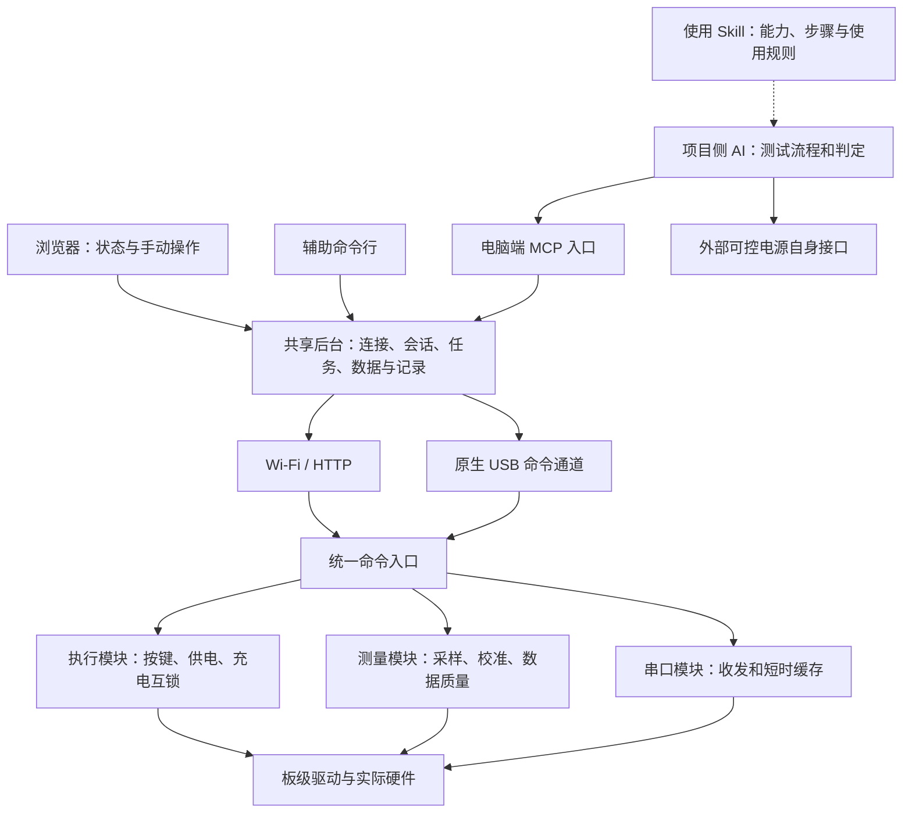

# MCU 开发辅助工具软件设计草案

日期：2026-11-12。

本文保留基于功能规格和硬件资料形成的历史软件设计。用户于2026-11-12批准按执行约定连续开发，现已形成0.1.1实现并按实装INA226完成首次烧录、启动检查；用户随后实测确认功能正常。具体操作以[软件使用说明](软件使用说明.md)和[设备协议](../protocol/设备协议.md)为准，最新状态及INA228历史方案与实板的差异见[实板记录](INA226实板启动与测量限制.md)，首版离线验证见[软件验证报告](软件验证报告.md)。

**建议采用 ESP-IDF 固件＋Python 电脑端，保留 Wi-Fi 和原生 USB 两个入口，共用一套命令与执行规则。工具提供通用操作和可信数据，具体测试流程及合格判定继续由项目侧 AI 负责。**

2026-11-12 按用户要求参考 MKLink 完善：软件组织采用“使用 Skill＋MCP＋共享后台＋网页＋设备固件”的设计方向，补齐设备身份、客户端会话、任务追踪和数据订阅。依据及适用差异见[MKLink 软件架构借鉴](MKLink软件架构借鉴.md)。本次新增细节仍为设计建议，不引入 MKLink 的自动恢复或兼容降级行为。

文中区分“已有约定”和“建议”。2026-11-12 用户已确认首版同时提供简单网页，用于查看状态和手动操作，并认可由电脑端程序提供网页，与 MCP 共用设备连接、状态和记录；这些内容同步记录到首版功能规格。具体布局和未明确的交互细节仍为设计建议。

## 1. 设计依据与当前硬件

主要依据：

- [首版功能规格](../.scratch/mcu-assistant/spec.md)：已确认的工具能力、职责及异常行为。
- [领域术语](../GLOSSARY.md)：被测设备、工具能力、设备测试配置等术语。
- [硬件方案](MCU开发辅助工具硬件方案.md)：网络、采样初值及连接关系；其中部分旧方案仍作为历史保留。
- [已回板物料统一修改记录](已回板物料统一修改记录.md)：2026-11-10 当前装配，测量芯片仍为 INA228。
- [原生 USB 接口改版核验](原生USB接口改版核验.md)、[串口发送直连改版核验](串口发送直连改版核验.md)、[四路电压单电源改版核验](四路电压单电源改版核验.md)：软件必须遵循的最新变更。

| 硬件能力 | 软件设计依据 |
| --- | --- |
| ESP32-S3-WROOM-1-N16R8 | 使用 16MB Flash、8MB PSRAM；具体 SDK、分区和内存预算在建工程时固定 |
| 五路 GAQY221S 按键触点 | GPIO4～8 控制，本地执行定时、连击和组合；实际触点时序需要测量 |
| 两路主供电＋独立充电开关 | GPIO11/12/13；主供电工作目标 2.8～12V、双向 3A，充电独立为 5V/2A |
| INA228＋20mΩ 四端分流器 | I²C 地址 0x40，测电池接口电压和双向电流；固定宽档 |
| ADS1115＋四路 TLV9001 | I²C 地址 0x48，四路顺序采样；单电源、名义 11 倍分压还原，近零允许偏差 |
| 目标 UART | GPIO14 发、GPIO15 收；TX 经电阻直连，禁用时 GPIO14 输入且无上下拉 |
| USB Serial/JTAG | GPIO19/20 专用；固件下载、工具日志、命令交互，与目标 UART 分开 |
| CONFIG 与状态灯 | GPIO17 与 GPIO16；支持人工配网及联网状态指示 |

I²C 使用 GPIO9/10。ADS1115 的 ALERT/RDY 未连接，按转换完成状态轮询；不因旧 GPIO 分配提案中有 GPIO21 就启用该中断。GPIO38 已释放，不作为 UART 发送使能。

以上引脚来自项目记录；实现板级定义时，仍应逐项对照最终原理图网表。设计目标不等于实测额定能力，能力查询应分别披露设计范围、校准状态和已验证结果。

## 2. 用户实际怎么使用

以检查某个被测设备的长按开机和休眠为例：

1. 人工接线，选择 USB 或 Wi-Fi，项目侧 AI 查询工具身份、能力、当前状态和校准状态。
2. AI 显式接通真实电池通路，要求工具执行一次持续 1500ms 的按键操作。
3. 工具自己计时并释放按键；网络往返不参与这 1500ms 的计时。
4. 电脑端持续保存目标串口、电池端电流、电压及操作记录。
5. AI 按项目要求等待设备稳定，再读取对应时段的数据，结合项目日志判断是否开机或休眠。

“休眠电流是否合格”“哪段日志代表开机”属于设备测试配置，不写死在工具固件里。外部可控电源仍由 AI 通过其自身接口直接调节。

## 3. 整体结构和技术选择

| 部分 | 建议 | 原因 |
| --- | --- | --- |
| 板上固件 | ESP-IDF＋C，使用其 FreeRTOS 和原生驱动 | 统一管理 USB、Wi-Fi、任务、定时器、NVS 及 S3 内存配置 |
| 电脑端 | Python＋FastAPI 共享后台，网页、MCP 和辅助命令行复用同一运行实例 | 统一设备连接、会话、任务和记录，避免多进程争用或状态各自维护 |
| AI 入口 | FastMCP 转交共享后台；配套使用 Skill 描述能力和调用规则 | AI 与人工操作共用执行规则，Skill 不承担设备通信 |
| Wi-Fi 命令 | 沿用已确认的 HTTP，结构化 JSON 请求与结果 | 便于检查请求和错误，适配约 1Hz 测量 |
| USB 命令 | 原生 USB Serial/JTAG 字节通道，承载同一命令模型 | 保留下载能力，同时可用于离线接线调试 |
| 实时数据读取 | 后台按序号分批读取板上缓存；网页订阅后台推送，MCP 按自己的读取位置取缓存 | 采集、显示和记录分开运行；高波特率吞吐需要单独验证 |
| 长期保存 | 电脑按次保存操作/测量 JSONL、串口原始字节及索引 | 可追溯操作与原始证据，便于项目侧另行分析 |
| 人工操作界面 | 已确认由电脑端提供简单网页；建议 Vue 3＋TypeScript＋Vite 构建单页操作面板 | 管理多区域实时状态和操作反馈，USB/Wi-Fi 共用页面和记录 |

ESP-IDF 与 Python 依赖选定后锁定具体版本。首版升级使用现有 USB 下载能力；OTA、完整桌面应用和通用测试流程编辑器作为另行讨论的范围。

USB 与 Wi-Fi 是人工选择的两个入口，没有自动切换、失败改走另一通道或自动重放动作的设计。USB 接电脑时沿用“不同时接 DC”的工具供电约定。

### 3.1 简单网页的设计建议

**已确认部署方式：启动电脑端程序后，在这台电脑的浏览器打开操作面板。** 页面经电脑端程序访问设备，由该程序持有 USB 或 Wi-Fi 连接并持续采集。MCP 入口也接入同一个运行实例，不能只复用代码却各自建立设备连接和记录状态。

这种方式需要电脑端程序保持运行，优点是两种设备连接方式可以共用页面、历史记录和操作规则。设备首次配网仍使用已有的配置热点页面，两者用途不同。

建议先做一个主页面，按以下区域组织：

| 区域 | 显示内容 | 手动操作 |
| --- | --- | --- |
| 顶部状态栏 | 设备名称、连接方式、连接状态、最后更新时间、记录状态 | 选择连接、连接/断开、开始/停止记录 |
| 供电与充电 | 当前供电选择、充电通路控制状态、电池接口实测电压 | 选择关闭/真实电池/外部电源，充电接通/断开 |
| 五路按键 | 各路控制状态、正在执行的动作和剩余时间 | 单击、设定时长的长按、连击、选择多键组合；取消当前按键动作 |
| 测量 | 电池接口电压、双向电流、四路电压、数据时间及校准/有效状态 | 选择查看的通道和时段；可提供低速趋势图 |
| 串口与操作记录 | 串口接收内容、发送状态、人工/AI 操作来源与结果 | 波特率设置、显式启禁 TX、文本/十六进制发送、查看及导出记录 |

桌面布局建议把状态栏放在顶部，供电/按键操作与测量并列，下方放串口和操作记录；较窄窗口改为纵向排列。参考 MKLink 后，前端建议具体化为 Vue 3＋TypeScript＋Vite，由 Python 后台提供构建后的静态页面及本地接口。增加可展开的后台状态区，显示客户端、操作占用、当前任务及记录状态；首版仍保持简单网页。

交互规则建议：

- 页面初次打开先查询设备状态。没有有效数据时显示“未读取”或“连接已断开”，不以 0V/0A 占位，也不使用模拟数据冒充连接成功。
- 点击后显示“执行中”，同一动作等待结果期间避免重复提交；收到完成结果后才更新相应控制状态。操作被拒绝时，在相关控件旁说明原因。
- 手动长按采用“设定时长后点击执行”，由板上计时；不依赖浏览器鼠标松开事件释放实体按键。
- 网页与 AI 的操作都显示来源和执行进度，并经过同一套状态版本检查与资源冲突处理。AI 的按键序列执行中，网页不能直接插入另一段按键动作；并发供电请求不能用旧状态覆盖新状态。多步骤 AI 测试期间如何交接给人工，仍需明确，不能把命令串行执行等同于整段测试独占。
- 数据过期、缺失或未校准时使用明确文字，不能只靠颜色区分。趋势图保留真实采样时间和缺口，刷新网页不会提高硬件采样率。
- 页面刷新或关闭不应隐式改变供电、释放控制权、取消板上动作或停止电脑端记录；再次打开查询同一运行实例。明确点击“停止记录”与关闭网页是不同操作。
- 操作按钮和输入框有文字标签、单位、键盘焦点和就近错误提示；列表限制页面渲染条数，长期原始数据继续由电脑端保存。

页面只提供工具已有能力的人工入口，不在页面加入外部电源调压或项目专属的通过阈值。

### 3.2 参考 MKLink 的共享后台设计

后台负责运行状态，网页、MCP 和辅助命令行只是调用入口。建议首版一个后台实例管理一块已选工具，按稳定设备身份防止重复持有；USB 端口和 Wi-Fi 地址可以变化，同一工具的两种连接必须返回相同 `device_id`。后台协议不匹配时明确报错，不新建独占连接绕过。

| 后台模块 | 集中承担的职责 |
| --- | --- |
| 设备连接 | 设备身份、USB/Wi-Fi 通信、握手、固件能力和连接状态 |
| 会话与操作占用 | 登记网页/AI/CLI 客户端，协调写操作，公开占用者和拒绝原因 |
| 任务 | 保存请求与板上动作关联、去重、执行进度、终态及结果未知 |
| 数据与记录 | 独立采集、公共缓存、各客户端读取位置、原始数据写盘及缺失标记 |
| 能力契约 | 统一操作名称、参数、结果、错误和资源要求，供各入口调用 |

只复用同一份 Python 代码不足以共享设备；MCP 不能自行打开串口，网页也不能另建一条设备控制连接。后台状态查询只读取现有状态，不为查询创建新的设备操作会话。

建议支持“多人观察、显式占用后操作”：AI 的多步骤测试可持有写操作权，网页继续观察；人工改变设备状态前明确交接。租期、失联释放和人工接管条件仍待确认，不新增自动抢占或替他人取消任务。跨电脑的 Wi-Fi 写入准入还需固件配合，本机进程锁不能代替它。

正常退出一个客户端与断开设备通信分开定义：前者不取消板上动作或停止其他使用者的记录，后者是影响所有订阅者的明确操作，也不等于关闭被测设备供电。沿用关闭页面后已开启记录继续运行的设计，不套用 MKLink 的最后客户端离开后约 5 秒退出规则。

电脑端到网页建议使用 HTTP 操作请求和 WebSocket 数据推送；设备到电脑仍使用 USB 帧或既有 HTTP 方案。两段通信分别定义，不因网页显示方式改变固件协议。WebSocket 失败明确显示断开，不新增轮询或换通道的自动降级。

## 4. 固件怎样划分

原则是把同一类规则集中在一个模块中。网络处理只负责收发，不能在 HTTP 回调中直接改 GPIO；USB 也不能另写一套互锁。

| 模块 | 对外职责 | 内部负责的复杂性 |
| --- | --- | --- |
| 执行模块 | 执行按键序列、选择供电、控制充电、查询动作进度 | 本地计时、资源冲突、两路互斥、先断后通、充电互锁 |
| 测量模块 | 提供带时间和质量信息的读数 | INA228/ADS1115 转换、顺序采样、校准换算、历史缓存 |
| 串口模块 | 配置、显式启禁 TX、收发原始字节 | 引脚高阻、发送队列、接收缓存、分块及溢出记录 |
| 命令模块 | 校验请求并交给相应模块，统一结果与错误 | 版本、请求编号、状态前提、执行记录、并发控制 |
| 系统模块 | 启动、配置、配网、状态灯及设备信息 | 启动默认状态、NVS、启动标识、复位原因、运行状态 |

板级 GPIO、I²C 和芯片寄存器封装在对应模块内部或板级驱动中，不对 AI 开放任意 GPIO/寄存器写入作为日常操作接口。

建议将有时序要求的执行、测量调度、UART 接收与通信处理分开运行；模块不必各自占一个任务。具体任务数量、优先级和栈大小通过首轮压力测试确定。

需要保证：

- 按键释放和供电切换不等待网络响应，也不等待 UART 日志发送完毕。
- ADS1115 等待转换时让出任务和 I²C 总线，不能长时间持有共享总线锁。
- 所有动作与数据传输队列有容量限制，满时明确拒绝或报告数据缺失，不无限积压。
- PSRAM 可用于较大的历史缓存；定时执行状态和驱动要求的内部缓冲按 ESP-IDF 的内存约束分配。

## 5. 必须先写清楚的行为

### 5.1 启动、断网与重连

已有约定：上电或重启后，五路按键释放，两路主供电和充电通路关闭，UART TX 高阻；正常运行 Wi-Fi 中断时保持供电及充电状态，定时按键按原计划结束。正常失联不自动开启配置热点。

实现顺序建议为：先设置业务引脚默认状态，再初始化持久配置、驱动和通信。软件只能控制开始执行之后的状态，上电至初始化前以及复位期间的引脚表现必须通过实物检查。

每次启动生成新的 `boot_id`，记录复位原因。重连先查询身份、`boot_id` 和当前状态；若工具重启，旧动作不能表述为“已完成”，未传出的缓存应标记缺失。

### 5.2 供电与充电

对外用 `off / battery / external` 三种供电选择表达，不允许调用方分别打开两路 MOS。

内部切换过程为：旧支路关闭 → 等待经过实测确定的关断间隔 → 新支路开启。间隔不能把“100ms 量级切换目标”直接抄成 100ms 固定等待；它取决于实际驱动和 MOS 关断表现。

已有互锁：非真实电池通路不能开启充电；充电开启时不能切换到模拟电池，冲突请求返回原因。

建议补齐的情况：充电开启时，切换到 `off` 也应拒绝，要求先显式关闭充电，从而保持“只有真实电池通路允许充电”的约束。此项需确认后实现，不擅自增加自动关闭充电、自动换源或其他连带动作。

**状态查询必须区分控制状态和测量结果。** 例如返回“外部电源通路控制已开启”及“电池接口测得 3.91V”；不能据 GPIO 电平声称 MOS 已真实导通，也不能由关闭通路推断设备已经掉电。现有电路没有主动放电，工具也不能辨认未被独立检测的输入端是否接有真实电池。

### 5.3 按键动作

建议统一使用有限长度的“按键序列”：每一步给出需要闭合的按键集合和持续时间。单击、长按、连击、组合只是这个模型的不同参数。

例如 K1 长按 1500ms、释放 100ms、K2 与 K3 同时按下 200ms：整段下发后在板上完成，结束释放本序列所用按键。首版建议一次只运行一段按键序列；序列自身支持多键组合，新请求遇忙直接返回原因，避免动作插入到不确定位置。

序列需定义总时长、步数上限、取消时的释放行为和最短间隔。已有要求为 1ms 设置步进、10ms 最短按下/释放间隔的设计目标；不把设置精度当作实际触点精度。

任务状态建议包含已接收、执行中、已完成、已取消、失败；完成表示控制序列执行完毕，不表示被测设备已按预期响应。

### 5.4 测量数据

测量持续运行，读取命令取得记录或等待指定条件的新记录，避免每调用一次才临时触发整套测量。

每条数据至少包含：通道、数值与单位、采样序号、设备启动标识、采样时刻或采样窗口、校准版本以及有效性/质量信息。电脑接收时间另存，不能冒充设备采样时间。

- 电流正方向定义为经分流器向被测设备供电，负方向为反向流动；不把它叫作充电器输入电流。
- INA228 初值沿用固定宽档、分流电压和 VBUS 各 2074µs、平均 128 次，名义完整周期约 0.531s；对外约 1Hz。动作后第一份记录可能包含动作前的数据，应提供采样窗口依据，而不是立即标为稳定值。
- ADS1115 初值沿用 ±2.048V、8SPS、四路单次顺序采样；每路独立时间戳。四个读数不是同一瞬间取得，不能用于承诺尖峰或同步波形测量。
- 四路电压在线性区按名义 11 倍还原并应用每路校准；旧负轨/偏置公式不可沿用，近零值不强制归零。
- INA228 电流、电池接口电压及四路外部电压分别校准。校准记录绑定设备、板版、算法版本和参考条件，写入 NVS；长期采样不反复写 Flash。
- 未校准、近零准确区间未验证、转换失败、过期和超量程要区分。无法提供有效测量时返回明确状态；如保留旧值，必须带原时间和过期标识，不能更新为新读数。
- 校准缺失或损坏时，不静默替换成其他系数并称为已校准；诊断需要的原始码与经过验证的测量结果分别表达。

板载读数不是快速硬件保护。沿用已确认范围，不增加自动限流、低压关断、测量失败换源等行为。

### 5.5 UART 和日志

目标 UART 保留原始字节；文本显示和协议解析在电脑端进行。工具自身日志、目标 UART 数据和命令响应分别标识，不能混成一种日志。

禁 TX 必须解除外设对 GPIO14 的驱动并设置输入、无上下拉，RX 继续工作。已有约定要求 AI 在被测设备掉电前先禁 TX。正在发送时禁 TX、发送排队与取消的关系需要确认：建议普通禁用先停止接收新发送请求，等待已提交字节发送完成，再进入高阻；超时返回未完成，不静默截断或另换行为。

`uart.write` 的“已入队”“工具发送完毕”和“被测设备已收到并处理”是三件事。后两者不能由入队成功推断，被测设备处理情况只能通过其协议或其他证据判断。

接收使用有界环形缓存，每块带偏移/序号及接收时间范围。921600、8N1 的满速数据约为 92,160 字节/秒；256KiB 仅约能保存 2.8 秒原始数据，实际还受元数据、调度及转发开销影响。缓存容量及保证吞吐需要实测，不承诺任意断网时长都不丢日志。

缓存满时保留新数据还是旧数据属于待确认契约。无论选哪一种，都必须记录缺失；硬件 FIFO 溢出无法精确统计丢失字节时，明确标为未知数量，不能编造连续日志。

## 6. 对外命令怎样设计

以下是逻辑能力草案，不是已冻结的函数名或 HTTP 路由。

| 能力 | 典型输入 | 应返回的关键内容 |
| --- | --- | --- |
| 查询设备 | 设备选择 | 唯一身份、硬件/固件/协议版本、能力及校准信息 |
| 查询状态 | 无 | 启动标识、控制状态、执行中动作、UART TX 状态、模块健康状态 |
| 执行按键序列 | 按键集合、持续时间、重复次数 | 动作编号、接收结果；可另查进度或取消 |
| 选择供电 | off / battery / external | 操作结果、控制状态、互锁拒绝原因 |
| 控制充电 | 开 / 关 | 操作结果及控制状态 |
| 读取测量 | 通道、起始序号、最大条数；可指定等待新记录 | 数据、时间、质量、下一读取位置及缺失信息 |
| 操作 UART | 配置、显式 TX 开关、发送字节、读取位置 | 发送进度、接收字节及缺失情况 |
| 查询/取消动作 | 动作编号 | 实际执行阶段、结果及是否已结束 |
| 开始/结束电脑端记录 | 设备与保存位置 | 本次记录标识、文件位置、采集状态 |

“设备测试通过”不作为底层命令返回值。MCP 可以提供易懂的操作名称，但不绕过这些统一规则。

### 请求和重复执行

建议每个请求携带协议版本、请求编号和参数；修改硬件状态的请求还携带预期的 `boot_id`。供电等依赖当前状态的操作可以带状态版本，防止用旧查询结果覆盖别人刚完成的操作。

固件在真正执行前检查互锁和资源占用，不只在收到请求时检查。USB 与 Wi-Fi 的写操作通过同一个执行入口串行裁决；读取可并行。首版建议以一个电脑端常驻进程统一处理网页和 MCP 调用，附带操作来源并共享状态。网页禁用按钮只是操作提示，实际冲突检查仍由电脑端与固件执行。

对有限窗口内相同请求编号与相同内容返回已有执行记录；相同编号而内容不同应拒绝。去重窗口及容量必须对外说明。超时只表示电脑没有获得结果，不能断定动作没执行；先查询动作记录，记录已不可用时报告结果未知，不自动重新点击、发送 UART 字节或切换供电。

参考 MKLink，电脑端对有执行过程的动作在发送前保存接受记录，关联请求编号、参数摘要、设备身份、`boot_id` 和板上动作编号。后台重启后先查询执行证据，不能确定则保留结果未知。电脑端任务结束、板上控制执行完成、被测设备响应符合预期三者分别表达；普通缓存读取不必全部包装成任务。

### USB 与 HTTP 的封装

命令参数、结果结构、错误码及动作状态共用一份协议定义。HTTP 使用 JSON；USB 可采用带版本、类型、长度和校验的有界消息帧，负载使用相同 JSON。目标 UART 二进制按块编码传输，避免按字节创建消息。

USB 应用日志也经统一发送队列封装为日志消息，避免多任务往同一字节流交叉写入。ROM 启动输出及不完整消息不作为有效业务响应；只接受完整合法帧，并通过设备握手识别本次启动。帧格式、吞吐和恢复到帧边界的行为应专门验证。

错误至少区分参数不合法、互锁冲突、资源占用、版本不支持、设备已重启、测量无效、历史数据缺失和动作结果未知。错误说明提供当前事实，不能暗中修改用户命令再执行。

## 7. 电脑端保存什么

每次记录创建独立目录，至少保存：

| 内容 | 用途 |
| --- | --- |
| 会话信息 | 设备身份、版本、连接方式、板版、校准版本和开始时间 |
| 操作及事件记录 | 谁在什么时刻发出什么命令，工具何时接收、执行、完成或拒绝 |
| 原始测量记录 | 数值、单位、设备采样时间/窗口、序号和数据质量 |
| UART 原始字节与块索引 | 保留二进制证据，并定位相应接收时段及缺失 |
| 采集缺失记录 | 区分网络中断、缓存覆盖、设备重启及电脑写盘失败 |

相对时序优先用设备单调时钟；电脑墙上时间用于人类定位。不同工具之间的时间关联带上同步误差，不能用网络收到消息的先后推断毫秒级硬件先后。

电脑端持续采集独立于单次 MCP 请求，AI 思考期间仍能接收并保存数据。MCP 返回有界数据、摘要及文件位置，不把全部高速串口日志直接塞进一次回复。

网页、MCP 与记录器各自消费同一来源的数据。网页暂停或隐藏只影响绘制，不停止采集和已开启的记录；一个客户端读取不会清空其他客户端的数据。记录器不依赖页面可见点数，慢页面不能阻塞板上动作或后台接收。区分设备端丢样、传输缺失、缓存覆盖、页面漏收和写盘失败，不把显示抽样当作原始数据丢失。

## 8. 推荐实施顺序与验收

| 阶段 | 完成内容 | 进入下一阶段前的证据 |
| --- | --- | --- |
| 1：最小固件和 USB | 建立 ESP-IDF 工程、固定板级定义、启动默认状态、USB 下载/握手、版本与状态查询 | 本次构建通过；USB 正反插枚举和下载；上电/复位各输出实测 |
| 2：基本硬件能力 | INA228、ADS1115、UART、按键序列、供电与充电互锁，均经统一命令入口操作 | 参考仪表比对；正反向电流；触点时序；先断后通；UART 高阻及收发 |
| 3：共享后台与简单网页 | 设备连接、会话/占用、任务、数据/记录模块，网页手动操作与辅助命令行 | 网页完成操作和记录；刷新/关闭页面不打断记录；重复请求、后台重启与结果未知可追踪 |
| 4：Wi-Fi、MCP 与使用 Skill | 人工配网、HTTP、MCP 共用后台；根据已实现能力编写使用 Skill | Wi-Fi 失联保状态；网页与 MCP 同源数据、独立读取、明确交接；USB/Wi-Fi 识别同一工具；AI 退出不影响其他使用者 |
| 5：校准和稳定性 | 校准流程、数据质量、满速串口与通信并行测试、缓存容量定值 | 有温度和参考仪表条件的精度报告；丢失可定位；连续运行记录 |

阶段 2 可以先进行原始采样与初步校准，阶段 5 完成可重复的正式校准及精度验收。阶段 1 优先 USB 只是开发顺序，不取消 Wi-Fi 作为已有主使用/验收入口。

正式测试围绕真实风险组织：互锁状态转换、通信超时后的重复动作、网络负载下的按键释放、四路采样时刻、数据过期/缺失、UART 二进制和 TX 高阻。芯片驱动和整机精度需要实物证据，纯软件测试不能替代。

每次涉及固件源码、配置或构建脚本的修改后，执行受影响工程编译并记录结果；没有实物测试时明确区分“编译通过”和“硬件行为通过”。

## 9. 已确认的实施规则与实物参数

用户已批准[首版软件开发执行约定](首版软件开发执行约定.md)。以下规则已纳入实现：多观察者、单操作持有者、明确交接；充电时切换/关闭主供电须先关充电；禁TX等待发送完成，最多5秒；缓存保留新数据并报告缺失；取消按键只释放其按键；CONFIG长按3秒进入配网。

软件限额已固定在设备协议及能力查询中：60秒写入活性期限、最多128步/600000ms按键序列、64项固件变更请求缓存、256KiB目标UART缓存。失联不自动转交写权或改变输出。后台使用稳定身份复用连接，同启动重连延续数据游标，任务结果按执行证据保存。

准确下限、实际MOS关断间隔、可保证的持续串口吞吐和校准系数仍需样机证据。100ms先断后通是可调整的本次启动工程初值，页面和能力查询均未声称其已经通过实物验证。
