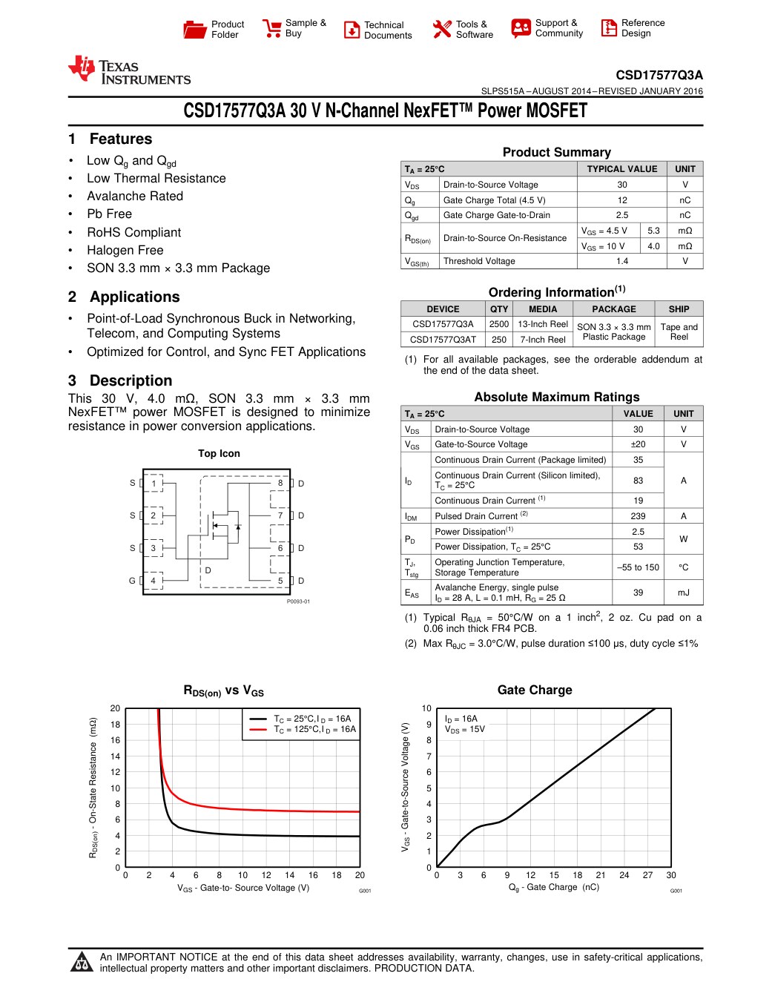
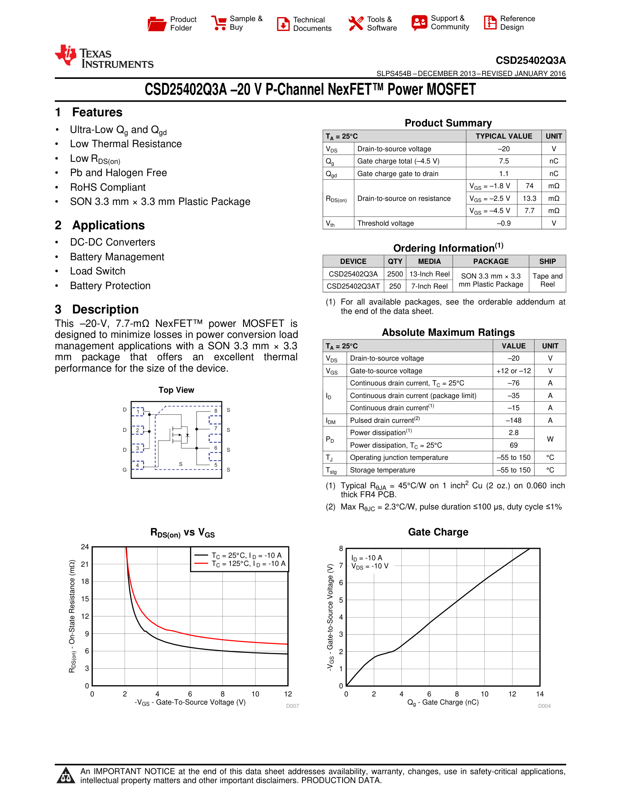

# MOS引脚图复核与连接更正

日期：2026-10-23。嘉立创真实器件库接入时发现两款MOS的引脚名与项目旧表不一致，因此重新下载TI原始PDF并查看第1页渲染图。**旧表的1～8脚关联有误，真实库在这项上与可见顶视图一致。** 本次更正连接记录和生成数据，不更换器件或修改共源背靠背架构。

| 器件 | 1、2、3脚 | 4脚 | 5、6、7、8脚 | 底盘9 |
| --- | --- | --- | --- | --- |
| CSD17577Q3A，N-MOS | Source | Gate | Drain | Drain |
| CSD25402Q3A，P-MOS | Drain | Gate | Source | Source |

N-MOS数据手册SLPS515A的本次文本抽取结果按顺序显示了“1 D、2 D、3 D、4 D、5 G、6 S、7 S、8 S”，但该页可见的Top Icon实际为上表排列。文字抽取不能保持该引脚图的可靠空间关联，必须以渲染图和机械图复核。前轮记录及后续本地数据复核沿用了错误映射，未独立纠正，本次已修正。

影响范围为主通路Q8～Q11、充电通路Q12/Q13及相应模块说明、关键引脚表、数据生成器与生成数据。两款器件原有底盘9的D/S判断保持正确；Gate由旧记录5脚改为4脚，源漏1～8脚同步按真实排列修正。未创建这些MOS原生图元前已发现问题，没有错误PCB或投板产物。

## 原图证据

- [TI CSD17577Q3A](https://www.ti.com/lit/ds/symlink/csd17577q3a.pdf)，SLPS515A，2016-01修订，第1页Top Icon。
- [TI CSD25402Q3A](https://www.ti.com/lit/ds/symlink/csd25402q3a.pdf)，SLPS454B，2016-01修订，第1页Top View。
- 嘉立创真实库记录见`hardware/easyeda-pro/rev-a/library-records.json`：C201632和C111356的符号引脚均与上表吻合，封装几何仍需与机械图单独核验。

后续核对不得只检查Gate底盘或位号数量；应逐一比较引脚编号、引脚功能、网络与封装焊盘位置。
