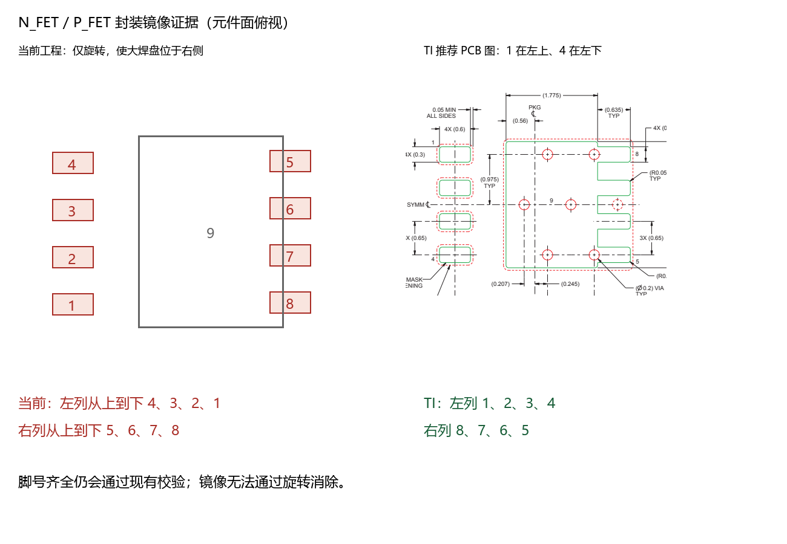

# 华秋 KiCad 原理图独立审查

**2026-10-24修复补充：F1/F2已修正并复核。** 6个迁移封装统一校正Y轴；MOS的Courtyard为3.8×4.15mm，并包含最大本体及至少0.25mm间隙。VOM同步补齐本体范围；新增几何校验可检出旧镜像及不足的装配边界。华秋10.0.6载入检查、网表回归和ERC通过。见 [修复预览](../hardware/kicad/preview/封装修复预览.png)、[几何结果](../hardware/kicad/verification/footprint-geometry.json)及 [完整检查](../hardware/kicad/verification/check.json)。J1/J2封装及下述制造/样机待验证项仍未定版。

后续核定补充：SHUNT4的两个感测铜盘已按Vishay推荐图修正尺寸和位置；J2已按HRO 2020-12-08图建立专用封装并绑定；J1已选定XKB DC-005-5A-2.0并按Rev A0图绑定专用封装。当前164颗器件封装全部绑定，详见[分流器核定](四端分流器封装尺寸核定.md)、[连接器核定](电源连接器封装核定.md)和工程README。

以下保留修复前的审查记录和证据，图中的“当前”指该次审查快照。

日期：2026-10-24。对象为 `hardware/kicad/AI_MCUTOOL.kicad_pro` 及其总览、八个功能子图、项目符号库、项目封装库与生成/校验脚本。

结论：现有原理图已具备继续审阅的基础，关键连接符合已确认方案；**发现两项封装缺陷，进入PCB布局前应先修正**。本轮为审查，只新增本报告、对比图和审查证据，没有修改原理图、封装、生成器或既有校验结果。

## 华秋版本及实际检查

系统安装记录为 **KiCad Huaqiu 10.0 (current user)，10.0.6**，安装目录 `D:\Application\kicad\install`。本轮全部KiCad导出和ERC均使用该目录下的 `bin\kicad-cli.exe`，没有使用另一套上游版安装。

| 检查 | 本轮结果 | 能证明的范围 |
| --- | --- | --- |
| CLI版本 | 10.0.6 | 华秋安装目录的实际可执行程序可调用 |
| 原理图解析、XML网表和PDF导出 | 成功，9页 | 当前工程可由该版本CLI加载和导出 |
| 新运行ERC | 0项违规 | 默认启用的电气规则未检出问题 |
| 元件及物理引脚 | 164颗、508脚 | 来自本轮重新导出的网表 |
| 网络 | 124个连接网络，另24个NC网络 | 不将NC计为功能连接网络 |
| 独立连接核对 | 129项通过 | 从已确认模块关系核对网表，不依赖 `binding.json` 作为判定依据 |
| 图面 | 新导出PDF的9页均已渲染查看 | 总览、八个功能页可读，未见明显遮挡导致的连接歧义 |
| 原工程快照 | 9个原理图与已有交付快照一致；本轮记录的原理图和封装文件哈希复查一致 | 本次没有重画、升级或覆盖其他AI的设计 |

独立连接检查覆盖双5V入口、CE与VOUT、LDO输出及散热片、ESP32电源和业务GPIO、五路浮动触点、两路共源N-MOS、充电P-MOS、四端Kelvin采样、两组I²C端点、四路分压与反馈、LM7705独立储能、UART发送使能及接收路径、关键NC脚。

ERC报告保留默认忽略的 `single_global_label`、`four_way_junction`、`simulation_model_issue`、`footprint_filter`。`--severity-all`不会主动启用这些规则。工程头部的 `generator_version "9.0"` 没有阻止华秋10.0.6解析，不能仅凭这一字段认定版本不兼容。

本轮兼容实测为CLI读取、ERC和导出；没有对正在打开的GUI进行编辑、重存或华秋gRPC写入测试。

## F1：P1——迁移封装出现镜像，功率MOS和光伏驱动的物理脚位不匹配

定位：

- [封装转换脚本](../hardware/tools/kicad_project_footprints.py:35)：来源库的 `centerY` 和 `padAngle` 直接写入KiCad封装，没有完成与目标封装视图一致的坐标变换。
- [N_FET封装](../hardware/kicad/AI_MCUTOOL.pretty/N_FET.kicad_mod:7)与 [P_FET封装](../hardware/kicad/AI_MCUTOOL.pretty/P_FET.kicad_mod:7)。
- [PHOTO_PV封装](../hardware/kicad/AI_MCUTOOL.pretty/PHOTO_PV.kicad_mod:7)。

### 功率MOS的直接证据

为便于比较，仅将现有封装旋转，使大散热焊盘位于右侧，与TI推荐PCB图对齐。引脚排列为：

| 观察位置，均为元件面俯视 | 当前N_FET/P_FET | TI两款器件的推荐PCB图 |
| --- | --- | --- |
| 左列，从上到下 | 4、3、2、1 | 1、2、3、4 |
| 右列，从上到下 | 5、6、7、8 | 8、7、6、5 |

左侧按实际焊盘中心和编号绘制简化示意，焊盘外形不作为制造尺寸依据；右侧摘自TI原始手册的推荐PCB图。

这组排列互为镜像，单纯旋转元件无法对齐。原理图和符号中的MOS电气定义是正确的：N-MOS的1～3脚为S、4脚为G、5～9脚为D；P-MOS的1～3脚为D、4脚为G、5～9脚为S。错误发生在对应脚号的PCB几何位置。

受影响实例为 **Q8～Q11（CSD17577Q3A）和Q12/Q13（CSD25402Q3A）**。若直接按这些封装布板并贴装，栅极会与源极或漏极位置错配，供电选择与充电开关无法按预期工作，并可能损坏器件。

依据为本轮从TI实际取得并渲染核对的两款原始手册第8页机械图、第9页推荐PCB图；推荐PCB图避免了把器件底视图误当作板上俯视图的问题。

### 光伏驱动的同类证据

Vishay VOM1271手册第5页的封装引脚图，按同样的上下两排方向观察，上排为4/3，下排为1/2；项目 `PHOTO_PV` 则上排为1/2，下排为4/3，同样镜像。影响 **U10/U11**。

其他经同一函数迁移的 `PHOTO_MOS`、`SHUNT4` 和 `SW4` 也应逐个复核。不能仅依据相同转换函数就认定它们的实际电气影响完全相同；特别是四端分流器要同时检查I/E端位置与尺寸。TLP176AM官方文档入口本轮返回403，未把旧核验记录冒充本轮重新取得的证据。

修复应在封装转换层核准来源与目标的坐标方向、旋转和元件面视图，并同步生成器与输出封装；随后逐器件对照厂家图确认焊盘位置、编号、1脚标识和散热焊盘。不能只改已生成文件而保留错误生成器。

### 为什么原有校验没有发现

[现有校验器](../hardware/tools/verify_kicad_schematic.py:88)对封装检查的是“符号脚号是否包含在焊盘编号集合中”。镜像不改变脚号集合，也不改变原理图网表，所以这类错误能够同时通过网表等价检查和ERC。

后续应增加已核物理焊盘位置或方向的验证依据。单纯增加网表比较次数不能覆盖封装几何缺陷。

## F2：P2——MOS装配边界没有包住最大器件本体

定位：[边界生成逻辑](../hardware/tools/kicad_project_footprints.py:40)及两个MOS封装的 `F.CrtYd`。

生成器仅用焊盘范围加0.25mm构造Courtyard，没有计入器件本体。当前两个MOS封装的Courtyard为约 **3.1653mm×4.1370mm**。

在与引脚排列对齐的方向上，TI机械图给出的对应本体最大尺寸为 **3.25mm**，已经大于3.1653mm这一侧的Courtyard，尚未加入装配间隙。器件即使通过Courtyard间距检查，仍可能出现本体空间冲突或装配间距不足。

修复时应按最大器件外形、引脚及焊盘的并集确定范围，再加入选定的装配间隙，并检查Fab层和1脚标识。该问题与F1的编号镜像分别修复；仅翻转坐标不会自动补齐本体边界。

## 既有未完成项

以下在原交付说明中已经记录，不列为本轮新发现的电气连线错误，但仍影响工程完成度：

- **J1/J2没有绑定PCB封装**：DC插座与Type-C座须按实际采购型号核对机械尺寸、脚号和外壳焊盘。
- **四端分流器封装尚待制造核定**：RSH1保持WSK2512R0200BEA、20mΩ、0.1%；其I/E逻辑连接在本轮网表检查通过，但这不证明现有几何与厂家焊盘图一致。
- **LDO散热、总输出电容稳定性和掉电反流**仍是电源定版条件；当前图中尚无额外反向保护器件，不能把LM66100的入口隔离当作LDO自身反流保证。
- **精度、MOS瞬态、默认状态和完整人民币BOM**尚无本项目PCB或样机结果。原理图检查不替代这些验证。

建议先处理F1/F2及连接器/分流器封装，再进行PCB放置、热设计和布线。

## 证据

- [本轮结构化审查记录](审查证据/华秋KiCad独立审查-20261024.json)：129项检查、封装坐标、输入文件SHA-256、CLI ERC摘要和官方资料取得记录。
- [TI CSD17577Q3A原始手册](https://www.ti.com/lit/ds/symlink/csd17577q3a.pdf)，SLPS515A，2016-01修订，第8～9页。
- [TI CSD25402Q3A原始手册](https://www.ti.com/lit/ds/symlink/csd25402q3a.pdf)，SLPS454B，2016-01修订，第8～9页。
- [Vishay VOM1271原始手册](https://www.vishay.com/docs/83469/vom1271.pdf)，Document83469，Rev.1.9，2023-08-08，第5页。
- [Vishay WSK2512原始手册](https://www.vishay.com/docs/30108/wsk2512.pdf)，Document30108，Revision11-Dec-2023，第2～3页，用于后续四端几何复核。

本轮下载资料、CLI原始输出及9页PNG位于 `docs/temp/kicad-independent-review-20261024/`，不覆盖原工程的 `verification/` 或PDF。
