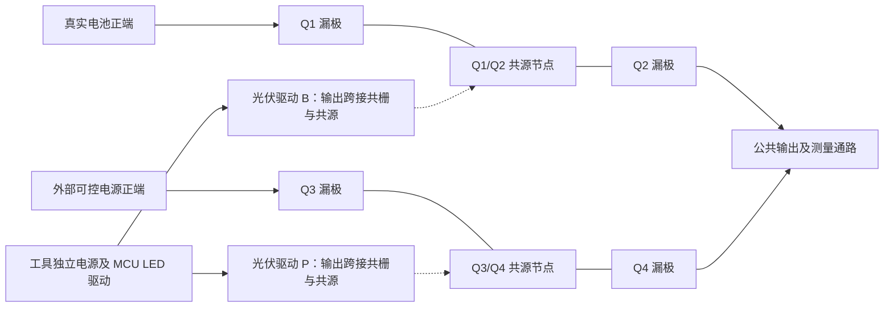

# 零至十五伏双向功率开关评估

调研日期：2026-10-16。本轮目标是评估主供电选择通路在正电压 0～15V、双向 3A 设计目标下的实现路线。真实电池与外部可控电源各有独立全关断开关；两路互斥，上电关闭，切换允许被测设备断电。独立充电器通路另按 5V/2A 评估。

这些是设计目标，尚没有原理图、样机、实测或报价。本文不增加自动换源、自动过流关断、自动恢复或其他 fallback 行为。

## 结论

**普通“高侧 P-MOS 栅极拉地”的方案不能覆盖接近 0V 的可靠导通。光伏 MOS 驱动器＋共源背靠背 N-MOS 有明确官方应用依据，可以列为优先验证候选。** 驱动能量由工具自身电源经过 LED 提供，浮动输出跨接 MOS 的栅源，不要求被测端提供最低工作电压。[S1]

已经实际核验的组合为 Vishay **VOM1271** 加两颗 TI **CSD17577Q3A**。两颗 MOS 在 VGS=4.5V、25°C 的最大导通电阻合计 12.8mΩ，3A 时约 38.4mV 压降、0.115W 发热，导通损耗具有研究价值。[S2]

它仍然不是已定型方案：光伏驱动输出仅为微安级，开通较慢；驱动器未列 VOC 最大保证，开关时间也不能从 200pF 测试负载直接外推。必须验证栅极实际电压、开通/关断时间、浪涌与 MOS 线性区 SOA、漏电和温度条件。当前证据支持做样机，不足以直接承诺整个 0～15V、双向 3A 范围全部达标。

## 为什么普通 P-MOS 拉地不满足本目标

若 P-MOS 源极接被控电源，栅极由下拉管拉至工具地，其导通驱动近似为 `VGS = −VIN`。输入降低时，栅源驱动也随之降低；接近 0V 时没有足够负 VGS。MOS 的阈值电压只说明开始通过极小测试电流，不代表可在该驱动下低阻承载 3A。[基本电路分析；RDS(on) 与阈值不能混用见 S2 §5.1]

换成逻辑级 P-MOS 可以降低所需驱动，却不能让“输入等于零时拉地”产生负 VGS；负压栅驱可以改变这一点，但增加了另一路驱动供电。单颗 MOS 还不能靠其关断状态阻断两个方向的体二极管电流。

本工具要求的是“通路在接近零电位时仍能被可靠接通/断开”，不是要求在 0V 源上凭空提供 3A 或输出功率。

## 光伏驱动的工作方式与候选连接

VOM1271 官方描述明确：内部工作和门极驱动所需能量全部来自隔离输入侧 LED 电流，不需要输出侧另设 VCC/VDD；官方第 4 页图 9 给出双向 MOS 驱动应用。[S1 第 1、4 页]

每条电源正端通路使用两颗 N-MOS：

1. Q1 的漏极 D 接该电源正端，Q2 的漏极 D 接公共被测设备供电节点。
2. Q1、Q2 的源极 S 相接，形成浮动节点 SCOM。
3. 两颗栅极 G 相接；光伏驱动器输出正端接 G，负端接 SCOM。
4. 驱动器输入 LED 从工具独立电源取电，通过限流和匹配的驱动级由 MCU 控制，默认不发光。
5. 真实电池支路与外部电源支路分别各用一组，不共用会导致两路无法独立关断的单颗 MOS。

图中的虚线只表示驱动作用，实际接线必须按上面的 G/S 说明及制造商图 9 绘制。两颗体二极管方向相反，从而在关闭时阻断任一方向的正常电压差；导通时沟道可承载正反电流。不是单颗 MOS 的“反接保护”接法。

光伏驱动隔离只存在于 LED 控制侧与门极输出侧之间。工具还会连接共地 UART、电压检测、充电器及其他测试线，**不能据此宣传整机或被测设备已经电气隔离**。

## VOM1271 的实际保证与限制

本次取得数据手册 Rev.1.9，2023-08-08，文档号 83469。以下电气表默认环境温度 25°C。[S1 第 2 页]

| 指标 | 数据手册值 | 使用含义 |
| --- | --- | --- |
| LED 正向电压，IF=10mA | 1.2V 最小、1.4V 典型、1.6V 最大 | 按电源容差设计限流和驱动电路 |
| 输出开路电压 VOC，IF=10mA | 7.8V 最小、8.4V 典型，未列最大 | 是开路值，不能直接当负载门极稳态保证值 |
| 输出短路电流 ISC，IF=10mA | 6µA 最小、15µA 典型，未列最大 | 不是门极升到 4.5V 时仍有 6µA 的保证 |
| 开通时间 | 53µs 典型，未列最大 | 条件为 CL=200pF、IF=20mA、脉宽 2ms、50% 占空比 |
| 关断时间 | 65µs 典型，未列最大 | 同一测试条件，不是两颗功率 MOS 的通用关断上限 |
| 快速关断 | 内置快速关断电路 | 输入 LED 熄灭后释放已充电门极，无需额外有源关断器件才能获得该功能 |
| LED 连续电流绝对最大值 | 50mA | 这是损坏边界，不是推荐工作值 |

官方也给出 VOC 与温度、ISC 与温度以及输出电流/电压的典型曲线，但它们不能替代表格中没有提供的全温最差保证。[S1 第 3～4 页]

### 默认关闭

驱动器有内置关断功能，LED 不发光时不应产生持续正向栅驱；但上电默认关闭仍需由 LED 驱动级的硬件默认状态、门极残余电荷释放和实际电源时序一起验证。不能只靠 MCU 初始化后写一次低电平。

以下场景需覆盖：工具冷启动、MCU 复位但外部电源已接入、工具突然失电、关断后立即更换电源电压，以及外部端口电压变化引起的米勒注入。内置“快速关断”不是无需测试这些场景的保证。

### 不能随意套用普通栅极下拉和稳压管

光伏输出为微安级。若在 G-S 加 100kΩ 电阻，8V 时需要约 80µA，已超过本器件 10mA LED 条件下的典型短路输出能力；1MΩ 在 8V 时约 8µA，仍会显著消耗驱动能力。按习惯加几十或几百 kΩ 的下拉可能让 VGS 达不到目标。

是否增加外部 RGS，应结合驱动器内置关断结构、全温门极/保护元件泄漏和所需静态电压核算。任何栅源钳位器件也要核验在实际工作电压与温度下的泄漏，不能仅凭“有保护更可靠”增加后就忽略其微安负载。

VOM1271 没有给出 VOC 最大值，本次不能宣称已完成最大驱动电压与 MOS 绝对最大 VGS 的最差匹配。候选 MOS 的 ±20V 栅源额定值比常见 ±12V 器件留有更大空间，但仍需获得制造商适用边界或通过明确设计约束闭合评审；典型温度曲线不是最大值保证。

## 两个在产 30V N-MOS 候选

| 参数 | TI CSD17577Q3A | AOS AON7408 |
| --- | --- | --- |
| 官方产品状态 | ACTIVE | Full Production |
| 封装 | SON 3.3mm × 3.3mm | DFN 3mm × 3mm |
| VDS 额定 | 30V | 30V |
| VGS 绝对最大值 | ±20V | ±20V |
| RDS(on)，4.5V、25°C | 最大 6.4mΩ | 最大 32mΩ |
| RDS(on)，10V、25°C | 最大 4.8mΩ | 最大 20mΩ |
| QG 至 4.5V | 典型 13nC、最大 17nC | 典型 3.5nC、最大 6nC |
| 关断漏电表列上限 | 1µA，VDS=24V、25°C | 1µA，VDS=30V、25°C；55°C 时表列 5µA |

来源：S2 第 1、3 页及 S3 产品状态；S4 第 1～2 页及 S5 产品状态。TI 首页概要与详细电气表的 QG 典型值存在不同，本文按第 3 页正式电气特性表的 13nC/17nC 计算。

两颗相同 MOS 串联的导通计算采用 **4.5V 下的最大电阻**，没有把 VOM1271 的典型 8.4V 当作已达到 10V 驱动：

| 两颗组成一条支路 | 总导通电阻 | 3A 压降 | 3A 总损耗 |
| --- | --- | --- | --- |
| 两颗 CSD17577Q3A | 12.8mΩ | 38.4mV | 0.1152W |
| 两颗 AON7408 | 64mΩ | 192mV | 0.576W |

以上不含温升后增阻、分流电阻、铜箔、端子及连接线。低压使用时，192mV 已是明显扰动；TI 候选更适合低压降目标，AOS 候选门极电荷较小、可能较快，但不能仅据此决定选型。官方 RDS(on) 的测试电流和温度条件见原手册，整机必须验证实际热环境。

30V MOS 对 15V 稳态端口有电压余量，但热插拔、线缆感性和电容浪涌可产生瞬态，不能只做静态电压比较。是否需要钳位及其漏电与能量等级仍是电路工作项。

## 微安门驱的速度与线性区问题

用 `t ≈ ΣQG / I` 可以建立量级直觉，但不能得到本电路保证的最大开通时间：

- TI 两颗至 4.5V 的典型总电荷约 26nC，除以典型 15µA，约 1.73ms；最大表列总电荷 34nC，除以最小短路电流 6µA，约 5.67ms。
- AOS 两颗对应约 7nC/15µA=0.47ms；12nC/6µA=2ms。

**这些不是典型/最坏开通时间保证。** 电流随着输出电压升高而变化，ISC 是零输出电压的短路值，可能高估实际充电电流；QG 的测试电流、VDS、米勒平台及最终门极电压也与实际负载不同。实际达到稳定低电阻可能更慢，关断也必须按双管实际门极负载验证。[S1 图 8；S2 §5.1；S4 第 2 页]

这一速度适合“上电、掉电、选择电源”类低频动作的可能性较大，不适合据此承诺 PWM 或精确电源边沿。慢开通时 MOS 会经过线性区：以 15V 和 3A 作为粗略瞬时上界，电压电流乘积达到 45W；这不等于持续损耗，但足以要求按 SOA 与真实浪涌波形检查，而不是只看导通后 0.115W 的发热。[S2 图 10；S4 图 9；工程分析]

两路换源必须先关当前支路，确认经过足够关断时间后才开另一支路。所需间隔不能从 65µs 的典型小电容测试直接确定；现阶段只保留互斥要求，不编造固定安全延时，不加入自动择优换源。可以研究硬件逻辑禁止两个 LED 驱动同时开启，其目的仅是实现已经确认的互斥。

## 与机械继电器比较

机械触点不需要被测侧电压驱动，天然可在接近零电位下连接，并能通过一个触点承载两个方向电流。但信号继电器与功率继电器不能仅凭外观互换，低负载可靠性和大电流能力存在不同侧重。

| 官方例子 | 可核实数据 | 对本项目的意义 |
| --- | --- | --- |
| Omron G6K 信号继电器 | 接触电阻初值最大 100mΩ；额定 1A/30VDC、最大切换 1A，额定通流 2A；低负载失效率参考条件 10µA/10mV | 有微小信号参考依据，但达不到本项目双向 3A 切换目标，不能直接采用 |
| Omron G5LE 功率继电器 | 标准 NO 额定 8A/30VDC；初始接触电阻最大 100mΩ，测量条件 5V/1A；失效率参考条件 100mA/5V | 电流额定足够的部分变体并不等于 µA 负载下也有相同接触可靠性依据 |

来源：S6 第 3 页；S7 第 1～2 页。失效率参考条件不是绝对最小可通过电流，也不是所有应用的可靠性保证；G6K 手册还指出该参考测试的接触电阻判据是 50Ω，不能拿它证明微小信号下始终只有 100mΩ。

100mΩ 接触电阻若用于 3A，单接点计算压降 0.3V、发热 0.9W；实际器件可能更低，但应按保证值、温度、寿命及连接总压降评估。机械方案还有线圈功耗、噪声、弹跳和寿命问题，优点是驱动时序与触点状态更直观。

因此机械方案可保留为对照研究路线；要找同时有足够 3A 直流切换能力与低负载性能依据的具体料号。不能把 G6K 的微小负载参考和 G5LE 的大电流额定拼成一个不存在的理想继电器。

## 当前推荐与验证入口

1. 优先搭建单条 **VOM1271＋两颗 CSD17577Q3A 共源背靠背** 原理样机；先在低能量条件验证近零端口时的 G-S 驱动和关断，再逐步验证 15V/3A，不直接定版两路整机。
2. 测试栅极电压与输出端波形、正反电流、关断漏电、工具失电/重启、端口先上电、容性浪涌、热插拔和最高预期温度；确认低压端的实际可用压降。
3. 需要闭合的具体指标包括：支路总允许压降、关断漏电、最大开关时长及端口允许电容/浪涌；它们影响外部设备行为，不应凭器件典型值补齐。
4. 主供电两路分别完整关断，充电器通路按独立 5V/2A 条件验证；供电支路的 15V 目标不能自动扩展为充电接口 15V。
5. VOM1271 的输出全温边界及最大 VOC 未闭合前，维持候选状态。没有完整 BOM/采购报价，不能承诺整机元器件 200 元以内。

## 其他光伏驱动候选的核验状态

Toshiba TLP3906 和 Panasonic photovoltaic MOSFET driver 是可继续查证的替代方向，但本次尝试的官方产品/PDF 路径返回 404，未取得其正式数据手册，因此没有引用其数值，也没有据记忆声称其具备同样的内置关断、输出电压或电流。该限制不影响已经取得 VOM1271 官方双向驱动应用的事实，但意味着本轮尚未完成三个品牌的定量比较。

## 一手来源与实际取数

本次实际通过 HTTPS 获取以下官方 PDF 并在内存中解析，另读取官方产品状态页；没有创建临时下载文件，没有使用商家模块参数或未核验的价格。页码为 PDF 印刷页码。

- **S1**：[Vishay VOM1271 官方数据手册](https://www.vishay.com/docs/83469/vom1271.pdf)，Rev.1.9，2023-08-08；第 1 页器件供能和关断说明，第 2 页电气/开关特性，第 3 页温度曲线，第 4 页图 8 输出特性和图 9 双向 MOS 应用。
- **S2**：[TI CSD17577Q3A 官方数据手册](https://www.ti.com/lit/ds/symlink/csd17577q3a.pdf)，SLPS515A；第 1 页额定值，第 3 页 §5.1 电气特性，第 5～6 页导通电阻、门极电荷和 SOA 图。
- **S3**：[TI CSD17577Q3A 产品页](https://www.ti.com/product/CSD17577Q3A)，本次读取状态 ACTIVE。
- **S4**：[AOS AON7408 官方数据手册](https://www.aosmd.com/sites/default/files/res/datasheets/AON7408.pdf)，Rev.9.1，2023-10；第 1 页额定值，第 2 页电气特性，第 3～4 页门极电荷、热及 SOA 特性。
- **S5**：[AOS AON7408 产品页](https://www.aosmd.com/products/mosfets/low-voltage-mosfets-12v-30v/aon7408)，本次读取状态 Full Production。
- **S6**：[Omron G6K 官方数据手册](https://omronfs.omron.com/en_US/ecb/products/pdf/en-g6k.pdf)，第 3 页 Characteristics、Contacts 及脚注，第 4 页接触可靠性说明。
- **S7**：[Omron G5LE 官方数据手册](https://omronfs.omron.com/en_US/ecb/products/pdf/en-g5le.pdf)，第 1 页额定负载，第 2 页接触电阻、测试条件、失效率参考值及动作时间。
